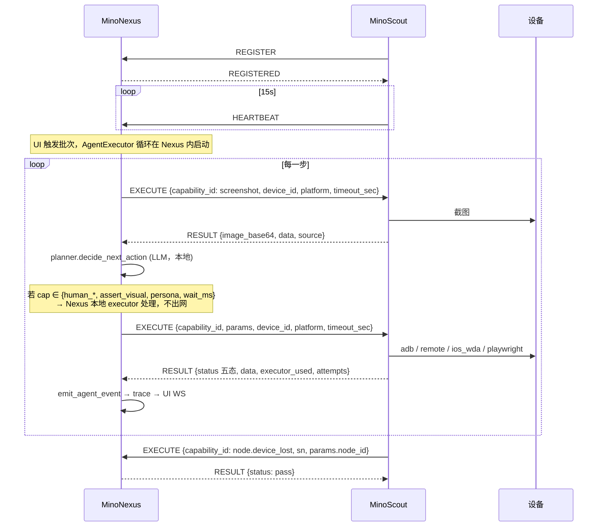

# PROTOCOL — MinoNexus ⇄ MinoScout

> **本文在 MinoNexus 与 MinoScout 两个仓库各有一份，必须逐字相同。**
> 契约真源是两仓同步的本文和协议实现；`tests/fixtures/protocol/*.json` 仅供本地校验，不提交 Git。改协议的流程见各仓开发指引 §5。
> 协议版本：`2`

用例步骤与框架指令的统一出入口是 `EXECUTE` → `RESULT`。截图、层级、探活、取消 run、节点 stop/restart/update、设备热插拔都是 `capability_id`，走同一套形状。线上只有五种 `type`：`REGISTER` / `REGISTERED` / `HEARTBEAT` / `EXECUTE` / `RESULT`。没有 `OBSERVE` / `PROBE` / `CANCEL_RUN` / `NODE_EVENT` / `NODE_COMMAND`。

加字段时 dumps **省略空值**（`device_id` / `platform` 空字符串、`data` 空 dict）。

---

## 1. 传输与连接

| 项 | 规定 |
|---|---|
| 传输 | WebSocket，文本帧，UTF-8 JSON，一帧一条消息 |
| 方向 | **Scout 主动 dial Nexus**。Scout 永不监听对外端口 |
| 端点 | `ws(s)://<nexus-host>:<port>/node` |
| 单机默认 | `ws://mino.local:10104/node` |
| 鉴权 | 首帧 `REGISTER` 携带 `token`（配对时由 Nexus 下发）。Nexus 校验失败即关闭连接，close code `1008` |
| 重连 | Scout 侧指数退避（1s → 2s → 4s → … 上限 30s），无限重试 |
| 心跳 | Scout 每 15s 发 `HEARTBEAT`；Nexus 45s 未收到视为节点掉线 |
| 大载荷 | 截图以 base64 放在 JSON 里。单帧上限 32 MiB；超限时 Scout 必须降质重发而不是分片 |

## 2. 消息信封

所有消息共用同一信封：

```json
{
  "v": 2,
  "type": "EXECUTE",
  "msg_id": "01J8ZQ...",
  "reply_to": null,
  "ts": "2026-09-02T15:30:01.123456+08:00",
  "payload": { }
}
```

| 字段 | 类型 | 说明 |
|---|---|---|
| `v` | int | 协议版本。收到不认识的版本：Nexus 关连接并在 UI 报错；Scout 关连接并退避重连 |
| `type` | str | 见 §3 |
| `msg_id` | str | ULID。发送方生成，全局唯一 |
| `reply_to` | str \| null | 应答类消息填对应请求的 `msg_id` |
| `ts` | str | ISO-8601 带时区 |
| `payload` | object | 各消息自己的载荷 |

**应答规则**：`ACK 必须` 的消息，接收方必须回一条 `reply_to` 指向它的消息；发送方超时未收到则按 §6 重试。

---

## 3. 消息总表

| # | 方向 | `type` | ACK | 说明 |
|---|---|---|---|---|
| 1 | S→N | `REGISTER` | 必须 | 上报身份、能力、挂载设备。应答 `REGISTERED` |
| 2 | N→S | `REGISTERED` | — | `REGISTER` 的应答 |
| 3 | S→N | `HEARTBEAT` | 否 | 保活 + 连通性/设备变化增量 |
| 4 | 双向 | `EXECUTE` | 必须 | 能力或框架指令。N→S：截图 / 点击 / `probe` / `cancel_run` / `node.stop` 等。S→N：`node.device_lost` 等热插拔 |
| 5 | 双向 | `RESULT` | — | `EXECUTE` 的应答，靠 `reply_to` 配对 |

> **协议里没有 `DECIDE` / `STEP_EVENT` / `RUN_FINISH` / `NEED_HUMAN`。**
> 执行循环在 Nexus（见 [ARCHITECTURE.md](ARCHITECTURE.md)），决策、trace 落库、问人全部在 Nexus 本地完成，不过网。
> 用例主通信只剩 `EXECUTE` ↔ `RESULT`。

---

## 4. 各消息载荷

### 4.1 `REGISTER`（S→N，ACK 必须）

```json
{
  "node_id": "3f8a1c0e9b2d4f71",
  "token": "<pair-token>",
  "platform": "darwin",
  "arch": "arm64",
  "scout_version": "0.1.0",
  "protocol_version": 2,
  "hostname": "mac-studio.local",
  "studio_id": "a1b2c3d4e5f67890",
  "executors": [
    {"id": "adb", "available": true,
     "provides": ["system_shell","system_pkg_install","system_pkg_clear","read_system_data",
                  "ui_native_input","ui_input_text","ui_screenshot",
                  "app_launch_native","app_force_stop","clipboard_set","key_event"]},
    {"id": "remote", "available": true,
     "provides": ["ui_native_input","ui_input_text","ui_screenshot","ui_stream",
                  "app_launch_native","clipboard_set","key_event","system_pkg_install",
                  "read_system_data","exec_script"]},
    {"id": "ios_wda", "available": false, "provides": [], "reason": "no WDA runtime"},
    {"id": "playwright", "available": true, "provides": ["ui_native_input","ui_screenshot"]}
  ],
  "devices": [
    {"sn": "R5CT30xxxx", "platform": "android", "model": "SM-S9210",
     "channels": {"adb": "connected", "remote": "connected"}},
    {"sn": "claw-abc123", "platform": "android",
     "channels": {"adb": "disconnected", "remote": "connected"}},
    {"sn": "web3f8a1c0e9b2d4f71", "platform": "web", "channels": {"playwright": "connected"}}
  ]
}
```

| 字段 | 规定 |
|---|---|
| `node_id` | 节点稳定标识，**不等于任何 `sn`**。取值 `[a-z0-9]{16}`（Scout 持久化的 `scout_id`），重启后不变。Playwright 槽 `sn` 为 `web` + `node_id` |
| `hostname` | 本机主机名，可空。只作展示 |
| `studio_id` | 写入本机 Scout 配置的工作台 id（`[a-z0-9]{16}`），可空。Nexus 据此记归属 |
| `executors[].id` | 必须是 `adb` / `remote` / `ios_wda` / `playwright` / `desktop` 之一 |
| `executors[].provides` | **abstract cap id 列表**。取值域由 `catalog_entries`（`kind=abstract_cap`）定义（Nexus 侧真源），Scout 只报字符串 |
| `account_isolation_version` | 新版 Scout 固定上报 `1`，表示会在收到已认证 owner 后才恢复本地插件；缺失或不支持时 Nexus 拒绝注册（1008），不会消费安装凭证。旧节点需升级后重新连接 |
| `executors[].available` | `false` 时 `provides` 必须为空数组，并给 `reason` |
| `devices[].channels` | 取值：`connected` / `disconnected` / `unauthorized` / `not_applicable` |

Nexus 收到后：`provides` ∩ 能力目录 → 该节点可执行的 capability 集合；`devices[]` 写入设备表并标记 `node_id` 归属。

### 4.2 `REGISTERED`（N→S）

```json
{
  "accepted": true,
  "session_token": "<short-lived>",
  "heartbeat_interval_sec": 15,
  "nexus_version": "0.1.0",
  "protocol_version": 2,
  "warnings": ["device claw-abc123 未在 Nexus 侧登记，已自动创建"],
  "node_id": "3f8a1c0e9b2d4f71",
  "node_token": "<long-lived>",
  "owner_user_id": "<verified-user-id>"
}
```

| 字段 | 说明 |
|---|---|
| `node_id` | 可选。Nexus 重分配 id 时下发；Scout 写入 `config.scout_id` |
| `node_token` | 可选。首次用安装凭证 REGISTER 成功后换发的长期 token；Scout 写入 `config.token` 并替换安装凭证 |
| `owner_user_id` | 认证成功时必填，由 Nexus 凭证/会话解析。Scout 确认本地插件 owner 与服务源一致后才恢复机器人；缺失、冲突或历史未归属配置都停用，不能继承旧凭据 |

安装凭证由登录账号签发，15 分钟有效。首次注册在 SQLite 同一事务内绑定账号和节点、消费凭证并生成独立长期凭证；重复登记仅允许同一节点在有效期内恢复同一长期凭证。不同节点使用已消费凭证、无效/过期/吊销凭证、长期凭证与 node_id 不匹配及跨账号重装必须拒绝。拒绝后关闭连接（1008），不接受任意非空或共享环境 token。`studio_id` 仅兼容，不授予账号权限。

Scout 重装保留 `scout_id` 和已有长期 token，先以 `pending_install_token`、`pending_nexus_url` 尝试本次绑定；成功持久化长期凭证后清理临时字段。明确拒绝时清理临时字段并恢复原账号连接；新机器没有旧凭证则停止等待用户重新生成命令。协议版本仍为 2，REGISTERED 增加可选解码字段 `owner_user_id`；新版在线执行要求该值非空。同步更新 golden fixtures。

`accepted: false` 时必须给 `reason`，Scout 记录后按退避重连（不要立刻重试，避免打爆）。

### 4.3 `HEARTBEAT`（S→N，不需 ACK）

```json
{
  "node_id": "3f8a1c0e9b2d4f71",
  "uptime_sec": 3721,
  "busy": true,
  "active_runs": ["run_20260902_153001_R5CT30"],
  "device_delta": [
    {"sn": "R5CT30xxxx", "channels": {"adb": "disconnected", "remote": "connected"}}
  ],
  "device_workload": [
    {"sn": "R5CT30xxxx", "run_id": "run_20260902_153001_R5CT30", "step_idx": 3, "capability_id": "tap"}
  ],
  "scout_version": "0.1.29",
  "host": {
    "mode": "running",
    "power_source": "ac",
    "charging": "not charging",
    "battery_percent": 80,
    "inhibit": true,
    "cpu_percent": 3.2,
    "rss_mb": 180.0,
    "children": {"Chromium": 1, "caffeinate": 1, "adb": 2}
  },
  "plugins": [
    {"class": "mail", "id": "gmail", "installed": true, "configured": false},
    {"class": "cli", "id": "feishu", "installed": false, "configured": false}
  ]
}
```

`host` 可省略。旧 Scout 不带时，列表功耗格显示「—」。`mode` 为 `running` 或 `asleep`。`power_source` 为 `ac` / `battery`。`charging` 为 `charging` / `not charging` / `charged` / `discharging`。`inhibit` 表示睡眠抑制还在（macOS 上即 `caffeinate` 还活着）。`children` 只数本进程的子进程。

`plugins` 可省略。省略表示这台 Scout 还不认识插件状态，网页显示「需更新后才能配置插件」。每项必有 `class` / `id` / `installed` / `configured`。非密钥明文放在 `values`（如 Gmail `inbox_address`），已写入保险库的字段名放在 `saved_secrets`。密钥值不上报。`class` 为 `cli` / `mcp` / `bot` / `mail` / `im`。`REGISTER` 使用同一份列表。

LangBot（`class=im,id=langbot`）的 `status` 描述进程，`platforms[平台]` 描述渠道，各含 `enabled/holding/connected/error/last_message_at`。新增可选的 `connection_verified: bool` 和 `connection_source: recent_message|unconfirmed`：`connected` 保留旧客户端的进程与配置判定，只有 `connection_verified=true` 才能展示真实连接；字段缺失或 false 时显示「待确认」，不能仅凭配置、安装或进程推断在线。当前确认来源为本次进程启动后 120 秒内收到的真实渠道消息，超期重新待确认；不能提供适配器持续连接保证。Nexus 原样保留这些字段，再统一输出规范化 `im_channels`。微信与普通通知机器人不混算。此为可选字段扩展，协议版本保持 2。

`runtime_capabilities` 可省略。省略表示这台正在运行的进程没有上报输入契约，Nexus 不凭版本号猜测它是否支持当前焦点输入。列表只含执行器实际实现的组合：`id`、`executor`、`platform`、`contract_version`、`supported_combinations`（`target_mode` + `write_modes`）。`REGISTER` 与 `HEARTBEAT` 使用同一份列表；心跳带上它，重启后的新进程才会被当成支持新契约。

`device_delta` 只报**变化**的设备；无变化时可省略。Nexus 据此更新连通性，并在下一次组装菜单时生效。权威设备状态以心跳为准；`EXECUTE node.device_*` 是即时通知。

### 4.4 `EXECUTE`（双向，ACK 必须，幂等）

能力和框架指令的统一出入口。超过 `timeout_sec` 接收方必须停止等待并回 `RESULT status=fail`（见 §6）。

```json
{
  "run_id": "run_20260902_153001_R5CT30",
  "step_idx": 7,
  "sn": "R5CT30xxxx",
  "device_id": "R5CT30xxxx",
  "platform": "android",
  "capability_id": "tap_element",
  "params": {"x": 512, "y": 830},
  "executor_order": ["remote", "adb"],
  "low_level": {"command": "TAP", "params": {"x": "{x}", "y": "{y}"}},
  "selected_impl": {"id": "vlm_locate_remote_tap", "needs_vlm": true},
  "device_hint": {"adb_serial": "R5CT30xxxx", "password": "***", "ttl_sec": 3600},
  "timeout_sec": 30
}
```

| 字段 | 规定 |
|---|---|
| `capability_id` | 能力或框架指令 id。Scout 不校验它是否存在于目录（目录在 Nexus），只看自己的 executor `supports()` 或内置框架 cap |
| `params` | **坐标一律是 0–1000 归一化千分比，不是像素。** Scout 负责按实际分辨率换算。观察类能力可带 `compress_ratio` 等。点击带 `point_policy`，两条路径不混用。`coordinate`：只用 `x,y`，禁止文案锚点、禁止吸附邻近节点。`node`：只用 `target` 锚点，未命中则失败，禁止用坐标兜底。未带 `point_policy` 时，有 `x,y` 按 `coordinate` 处理，不锚点、不吸附 |
| `device_id` | 可选。设备唯一 ID；空则回退 `sn` / `device_hint`。**dumps 时空字符串省略** |
| `platform` | 可选。`android` \| `ios` \| `web` \| `playwright` \| `other`。空则从 `sn` / `device_hint` 猜测。**dumps 时空字符串省略** |
| `sn` | 设备串号；web/playwright 可为槽位 sn 或字面 `playwright` |
| `executor_order` | **由 Nexus 按这台 `sn` 算好**，只含该设备适用的通道（Web 不得含 `adb`，安卓/iOS 不得含 `playwright`）。同设备内的 fallback（如同一部安卓的 `adb`→`remote`）可以是列表；**禁止把不同类型设备的通道排进同一条链。** 非空时 Scout 只在该 `sn` 上按序尝试，类型不符的 executor **declined，不碰设备**。空则按 **该 sn 的 platform** 填：android→`adb,remote`，ios→`ios_wda`，web/playwright→`playwright`。**禁止** other 四通道混排 |
| `low_level` | 抄自能力目录 YAML 的 `low_level` 段。`{x}` 这类占位符由 Scout 用 `params` 填充 |
| `device_hint` | Nexus 注入的设备凭据，避免 Scout 回查。Web 可含 `headless: true`（Chromium 无头）。**含敏感字段，不得写入 Scout 的日志** |
| `timeout_sec` | 本动作上限。超时回 `fail`，见 §6 |

**幂等**：`(run_id, step_idx)` 是 wire 唯一键，Scout 登记完整 Execute 内容。相同键不同内容拒绝为 `request_key_conflict`；在途重复返回 `request_inflight`。完成后业务/插件动作重复返回缓存结果，不重新执行；允许的只读刷新见 §9。`step_idx=-1` 只表示 Nexus 调用方尚未分配辅助编号，不能直接上线路；首次发送前补独立负编号，同一载荷重发保留编号及完整内容。不同截图、探针、插件消息和 ACK 必须是不同请求，不能因负编号就绕过守卫。

`compress_ratio`（`1.0` = 不压缩）对 **playwright 与 adb** 都生效：按比例缩小后，大于 1 时转 JPEG。Nexus 按渠道填入当前跑用例模型的 `web_compress_ratio` 或 `android_compress_ratio`，Scout 不读设置。**`RESULT` 里的 `width` / `height` 始终报原图尺寸**，坐标体系不受压缩影响。喂给大模型的图另按 `plan_compress_ratio` 统一转 JPEG，与渠道无关。

#### 4.4.1 `capability_id` 清单

| `capability_id` | 方向 | 说明 |
|---|---|---|
| `screenshot` | N→S | 截图。`params.compress_ratio` 对 playwright 与 adb 都生效 |
| `hierarchy` | N→S | UI 层级 dump |
| `get_app_version`（别名 `app_version`） | N→S | 目标包版本 |
| `get_foreground_app`（别名 `foreground_app`） | N→S | 前台包名 / bundle id |
| `probe`（别名 `probe_device`） | N→S | 重探连通性，结果在 `RESULT.data` / `extra.channels` |
| `cancel_run` | N→S | 不再继续该 run，不回滚已发到设备的动作 |
| `node.stop`（别名 `stop`） | N→S | 应答 RESULT 后 Scout 退出 |
| `node.sleep` | N→S | 不退出。放开睡眠抑制并关掉 Chromium，心跳继续，`host.mode=asleep` |
| `node.wake` | N→S | 节点仍连接时重新抑制睡眠。不在这一步开浏览器 |
| `node.restart`（别名 `restart`） | N→S | 应答后自拉起再退出 |
| `node.update`（别名 `update`） | N→S | 无远程装包路径则 `fail` |
| `node.log_tail` | N→S | 读本机 Scout 日志 tail。`params.lines` 默认 200，上限 2000 |
| `node.device_lost` | S→N | 设备消失。`params.node_id` / `detail` / `severity`；`sn`/`device_id` 为设备 |
| `node.device_found` | S→N | 设备出现 |
| `node.channel_changed` | S→N | 通道状态变化 |
| `node.engine_crashed` | S→N | WDA / u2 agent 等崩溃 |
| `node.shutting_down` | S→N | 人主动停。Nexus 立刻失败该节点在途 run。Scout 会在这条之前再发一帧 HEARTBEAT |
| `node.update_progress` | S→N | 远程/本机自更新进度。`params.progress`：`stage` / `label` / `percent` / `layer` / `bytes_*` |
| `node.plugin_install` | N→S | 按发布清单安装一个 CLI / MCP。`params.class` + `params.id`。不接受临时 URL |
| `node.plugin_remove` | N→S | 卸掉该插件目录，并删掉它在本机保险库里的密钥 |
| `node.plugin_config` | N→S | 写入该插件参数。密钥只留在 Scout 本机保险库，应答里不回显 |
| `node.plugin_progress` | S→N | 插件安装进度。形状同 `node.update_progress`，另带 `class` / `id`，不写入自更新的 `update_job` |
| `plugin.gmail.fetch_otp` | N→S | 用这台节点自己的 Gmail 应用专用密码取验证码。参数只有 To、时间、发件人过滤和轮询预算，没有密码 |
| `plugin.cli.feishu` | N→S | 用这台节点的飞书应用凭证读文档。参数是 `action=read_doc` 和 `url`，没有 `app_secret` |
| `plugin.cli.meego` | N→S | 用这台节点的 Meego 插件凭证换票或查工作项。参数没有 `plugin_secret` |
| `plugin.bot.send` | N→S | 飞书机器人或企业微信 webhook 发文本。`kind` 为 `feishu_bot` / `wecom`，没有 webhook |
| `plugin.bot.wechat` | N→S | 这台机器上的微信扫码、状态、发送。回执没有 `bot_token` |
| `node.plugin_wechat_message` | S→N | **旧事件，仅为兼容旧版 Scout 保留**，新版 Scout 发 `node.plugin_im_message`。微信收到一条文本。Nexus 生成回复后再发 `plugin.bot.wechat`。不在日志里写正文 |
| `node.plugin_im_message` | S→N | IM 收到一条消息（微信 iLink、LangBot 渠道）。`params.im` 为统一形状：`channel` / `instance_id`（实际机器人实例，必须与节点快照一致） / `tenant` / `chat_id` / `chat_type`(`private`\|`group`) / `sender_id` / `msg_id` / `text`(≤2000) / `mentioned` / `reply_ctx`(不透明的字符串字典，原样回传) / `recent_turns`(本会话最近至多 8 轮 `{role,text,ts,instance_id,tenant,sender_id}`，每条 ≤500 字，由 Scout 本地库取出)。Nexus 不落正文，不在日志里写正文。身份按 channel + instance_id + tenant + sender_id 精确绑定，并校验节点 owner 与持有权；绑定码只属于该 owner，一次性消费。缺实例或消息 ID 的旧回调不执行；收到消息先原子去重，群聊不能借用其他发送者身份。历史按 owner + 实例 + 租户 + 实际发送者隔离；Nexus 只接受当前绑定确认之后的历史，不把旧绑定或群内其他成员的正文作为上下文。每次模型调用、工具执行及回复前复核绑定代次，解绑或重新绑定使旧请求失效 |
| `plugin.im.send` | N→S | 经该节点向某个会话发一条消息。`channel` / `chat_id` / `sender_id` / `reply_ctx` / `text`。Scout 把发出的正文写入本地库。回执 `data.ok` |
| `plugin.im.history` | N→S | 读这台节点本地库里某个会话的正文。`channel` / `chat_id` / `sender_id` / `reply_ctx`（instance_id、tenant） / `after_ts`（当前绑定时间） / `limit`(≤100)。回执 `data.messages=[{role,text,ts,instance_id,tenant,sender_id}]`。正文只经这个能力现取，Nexus 不缓存 |
| `tap_element` 等 | N→S | 仍走 executor；Nexus 给该 sn 的 `executor_order`，Scout 按 sn 执行 |

`node.stop` / `node.restart`：Scout core 在 RESULT 的内部 extra 里打标记，transport 回完 RESULT 后再 shutdown。**不能靠 `node.stop` 或 `node.wake` 启动一台已经离线的专机。** `node.sleep` 不打退出标记。

S→N 的框架事件可丢（超时未等到 RESULT 时 Scout 只记 warn）；权威状态以 `HEARTBEAT.device_delta` 为准。

#### 4.4.2 `hierarchy` 的 RESULT 形状（NavFSM 依赖，两仓钉死）

`hierarchy` 是**结构化**的，不是一坨文本。`RESULT.data["nodes"]` 是节点数组，
`RESULT.extra["nodes"]` 是同一份数据的镜像（Scout 侧 `_result_from_event` 同时填两处），
接收方读任一即可，**不要**假设只有其中一个存在。

```json
{
  "status": "pass",
  "summary": "UI 层级 128 节点",
  "executor_used": "adb",
  "data": {
    "source": "adb",
    "elapsed_ms": 41,
    "nodes": [
      {
        "resource_id": "com.example.app:id/tab_feed",
        "text": "Tab A",
        "content_desc": "",
        "class": "android.widget.TextView",
        "clickable": true,
        "bounds": [0, 1848, 270, 1968],
        "center": [135, 1908]
      }
    ]
  },
  "extra": {"nodes": [/* 同上 */]}
}
```

| 字段 | 规定 |
|---|---|
| `hierarchy_format` | **`accessibility_json`**。这是本协议唯一的 hierarchy 形态；`flat_text` / `xml_dump` 不是协议形态，只能是接收方自己派生的展示文本 |
| `nodes[].resource_id` | 完整 id，含被测应用包名前缀（`{package}:id/...`）。可能为空串 |
| `nodes[].text` / `content_desc` | 可见文本 / 无障碍描述。可能为空串 |
| `nodes[].class` | 控件类名全称 |
| `nodes[].clickable` | 布尔 |
| `nodes[].bounds` | `[left, top, right, bottom]` |
| `nodes[].center` | `[x, y]` |
| `data.source` | 采集**通道** id，当前恒为 `adb`（与 `executor_used` 同值）。Scout 内部的 dump 来源（u2 / exec-out / 落盘）只进 Scout 日志，不上协议 |
| `data.elapsed_ms` | 本次 dump 耗时 |

> **坐标体系警告**：`bounds` / `center` 是**设备像素**，与 §4.4 里 `params` 的 **0–1000 千分比**
> **不是同一个体系**。拿 hierarchy 的坐标直接塞进 `tap_element.params` 会点偏。要换算的一方自己按
> `RESULT.width` / `height`（截图报的原图尺寸）折算。

**通道限制与失败语义**：

| 场景 | 行为 |
|---|---|
| web / playwright 槽 | `status=pass`，`data.source=playwright`，`nodes` 为 **DOM 快照**（`input`/`button` 等，`class` 为 HTML tag 或 `tag:type`）；**不是**安卓 `android.widget.*` |
| 非 adb 序列号（如远程 `claw-` 设备） | `status=fail`；`remote` / `ios_wda` 通道待后续版本 |
| dump 失败（设备忙 / agent 挂） | `status=fail`，`error` 汇总各来源的失败原因 |

`hierarchy` 是观察类能力，每次新观察使用独立 `step_idx< -1`；同请求的重取仍经过完整请求守卫。Scout 侧有 1.5s 的 TTL dump 缓存，
动作执行后会主动失效；调用方要最新一帧就跟在动作之后取。

Nexus 侧收到 `fail` 时**不得**让本 turn 失败：按 `docs/NAVIGATION_ATLAS.md` §10.0.2 降级
（`hierarchy_text` 置空、localize 退回 session + history、GuardGate 本 turn 不 block）。


### 4.5 `RESULT`（双向）

所有 `EXECUTE` 共用应答类型，靠 `reply_to` 区分。

```json
{
  "run_id": "run_20260902_153001_R5CT30",
  "step_idx": 7,
  "status": "pass",
  "summary": "remote TAP (512,830) -> ok",
  "error": "",
  "executor_used": "remote",
  "source": "remote",
  "elapsed_ms": 412,
  "attempts": [
    {"executor": "remote", "status": "pass", "elapsed_ms": 412}
  ],
  "image_base64": "",
  "image_mime": "",
  "width": 0,
  "height": 0,
  "extra": {},
  "data": {}
}
```

| 字段 | 规定 |
|---|---|
| `status` | **五态之一（小写）**：`pass` / `fail` / `skipped` / `blocked` / `declined`。取值与上游 `EventStatus` 逐字一致。Router 的处置见 §4.5.1。超时用 `fail` |
| `executor_used` | 实际执行的 executor id。**不可省略**，Nexus 的 trace 与覆盖度依赖它 |
| `attempts` | fallback 链的逐次记录。全部失败时 `status` 取最后一次的结果 |
| `image_*` / `width` / `height` | 截图时填；也同时放进 `data` |
| `data` | 任意返回参数（截图、层级 nodes、probe channels、能力原始结果）。**空 dict 时 dumps 省略** |
| `error` | 失败原因，面向人。**不得包含 `device_hint` 里的凭据** |

Scout **任何情况下不得让异常逃出** —— 内部异常一律转成 `status: "fail"` + `error`。Nexus 收到 S→N 的框架 `EXECUTE` 后必须回 `RESULT`，不能让 Scout 干等。

#### 4.5.1 五态与 Router 处置

取值与上游 `server/services/ai/regression/schemas.py::EventStatus` 逐字一致（**小写**，且是 `pass` 而不是 `OK`），避免搬迁时到处翻译名字。

| status | Router 行为 | 语义 |
|---|---|---|
| `pass` | 立即返回 | 做成了 |
| `blocked` | **立即返回** | 需要人介入 —— 换 executor 没有意义 |
| `declined` | 试下一个 executor | 主动让位，**不算故障**（日志 info，不计失败） |
| `fail` | 试下一个 executor | 真故障，但仍兜底换通道再试一次 |
| `skipped` | 试下一个 executor | 本次未执行（前置不满足等） |

**只读或有写前 no 回执时，`declined` 与 `fail` 才允许走 fallback**，区别在**是否算故障**，不在"换个 executor 有没有用"。只有 `blocked` 会中断 fallback 链。

`skipped` 是 executor 也会返回的值（上游 executors 里出现 6 次），不是 Nexus 独有的编排态。

---

## 5. 时序



---

## 6. 超时、重试、幂等

| 场景 | 规定 |
|---|---|
| Nexus 等 `RESULT` 超时 | 用 `payload.timeout_sec` + 5s 宽限。正编号请求不重发；负编号只读可按同一键重发一次。UI 写无回执记结果未知并隔离，不使用新键重放 |
| Scout 执行超过 `timeout_sec` | 立刻回 `RESULT status=fail`，`error` 说明超时。实现是 `fut.result(timeout=timeout_sec)`：**Python 线程无法强杀**，底层 adb / 设备动作可能仍在跑 |
| Scout 收到重复 `(run_id, step_idx)` | 先比较完整内容；冲突/在途明确拒绝，已完成业务或插件动作返回缓存 `RESULT`，**不重新执行**。允许的只读刷新见 §9 |
| 连接断开 | Scout 退避重连并重发 `REGISTER`。在途 `EXECUTE` 的结果若已产生，重连后 Nexus 重发同键请求即可取到缓存 |
| Nexus 重启 | Scout 的 `REGISTER` 会重建节点登记。在途 run 由 Nexus 侧判为中断，不尝试续跑 |
| S→N 框架 `EXECUTE` / `HEARTBEAT` 丢失 | 允许。状态最终由下一次 `HEARTBEAT` 收敛 |

**Scout 侧不做业务重试。** 同一动作、**同一台 sn** 换 executor（如安卓 `adb`→`remote`）由 `executor_order` 表达；不得用列表把 Web 和安卓通道串起来。同一 executor 内的机械重试（如 adb 偶发 `device offline`）允许，但必须记进 `attempts`。

---

## 7. 兼容性

- **加字段**：允许，接收方必须忽略不认识的字段
- **加消息类型**：允许，接收方对未知 `type` 记 warn 并忽略（不可关连接）
- **改字段语义 / 删字段 / 改 `type` 名**：不允许，必须 `v` 加一
- 双方在 `REGISTER` / `REGISTERED` 交换 `protocol_version`，不一致时**低版本方拒绝连接并明确报错**，不做降级协商

---

## 8. 本地 Fixture 哈希

本地调试时可用 `tests/fixtures/protocol/` 校验协议实现，两仓若有样例应保持一致；这些文件不纳入 Git。

```
fixtures_sha256 = 0be21298b045a908bb1a829cdb12413035724416327ff26eea33812a2ffebfa5
```

有本地样例时，两仓各自确认：① `protocol.py` 能 round-trip 全部 fixture；② fixture 目录哈希与上面记录一致。

哈希算法：按 JSON 文件名字典序拼接每份 `文件名 UTF-8 + 换行 + 原始文件字节`，再取 SHA-256。


## 9. Desktop additive contract (2026-10-12)

协议保持 v2；新字段均可缺省，不按 Scout 版本猜桌面能力。旧设备 fixture 不增加空字段。

- `REGISTER.host` 与 `HEARTBEAT.host` 由 Scout 上报实际 OS/arch/hostname 与 `desktop` 探测状态。持久化在 SQLite `nodes.extra`。
- `DeviceManifest` 增加 `os`（macos/windows/linux）、持久逻辑槽 `session_key`、临时 `session_generation`、`desktop_state`、`blocked_reason`、可空 `capabilities` 和 `readiness`。持久化在 SQLite `m_device.extra`，设备家族为 `platform=desktop`。
- 主桌面 SN 为 `desktop:<node_id>:console`。一个节点只能上报自己的槽及实际宿主 OS；窗口和显示器不生成设备。无 GUI/锁屏/缺权限/缺插件保留逻辑槽且通道为 disconnected，不表示可执行。
- `HEARTBEAT.executors` 是可缺省的执行器状态增量，用于权限或插件变化后刷新 Desktop 的 available/provides/reason；不发送时保留旧状态。
- `device_delta` 比较完整 manifest；会话代次、能力或权限变化也必须发送。Nexus 替换完整设备状态，不能只合并 channels。
- `EXECUTE.device_hint` 带 `os/session_key/session_generation/desktop_lease/target_package`。任务创建时冻结代次，Desktop 输入必须持有当前任务的 SQLite 独占租约。Scout 重启或 Cua readiness 状态变化使旧代次失效，不能用新心跳给旧任务续代次；系统会话及窗口的实际输入准入由 SDK 最终校验。
- Desktop 只路由 `desktop` executor。未知平台显式拒绝，不落回 ADB 或 Playwright。截图 capture_id、OS session_generation、SDK snapshot_id 与报告截图 hash 是不同身份。
- SDK 连接在一个桌面 worker 中持续复用。每次动作尝试消费最近一次截图引用，捕获绑定点击使用 Cua capture_id；超时视为结果未知，停止该 runtime 后续操作，不能自动换通道再输入。取消阻止新动作，不回滚已发生的输入。
- Desktop 与该节点 headed Web 共享 `desktop:<node_id>:console` 锁；headless Web 保留四路独立并发。SQLite 事务同时建立设备租约和任务，终态释放租约。
- Native macOS/Windows 采用 Cua Driver 0.34.1，按锁定 SDK wheel API 对齐；会话、权限与平台 readiness 消费 Cua health_report，窗口捕获和输入准入由 Cua 校验，Linux 暂不开放执行。Windows fixtures 覆盖就绪、锁屏与 Session 0；真实硬件验收与二进制发布另行记录，不将契约验证当作实机通过。Cua perception 不在此切片。
- `RESULT.extra` 保留精简动作证据 `cua_action`（effect/route/delivery/error.code/escalation），不保存输入正文或 SDK 原始 JSON。Nexus 在 `tool/result` 追加可信派单元信息 `scout`、`attempts` 和 `desktop`；未涉及任务的进程启动/注册/重连日志仍仅在 Scout 本地日志中。

## Desktop 输入与执行证据补充（0.1.76）

不改变消息 envelope 或 fixture 字段。Desktop `input_contract` 按 executor 上报 `current_focus` + `replace` / `append`，Nexus 不复用 Android 的 ADB 输入准入规则。点击使用服务端注入的、绑定 run_id 与事件 seq 的 focus_ref；Scout 保存窗口与字段落点，在新窗口捕获中经 Cua 重新定位字段，再执行窗口输入，引用不能跨代际或任务复用。不再使用项目原生焦点探针。

OBSERVE 的 screenshot 与 RESULT 的执行诊断通过 capture_id、session_generation 对齐。Nexus 的 Session Log 主动作和恢复子动作记录实际 executor、节点、尝试链、桌面 effect/route 与 evidence.kind；不复制原生证据自由文本详情。截图引用来自 Scout，网页所属系统不能替代节点上报的宿主 OS。

## Desktop 窗口托管补充（2026-10-12）

消息 envelope 和 protocol dataclass 不变；以下元数据经既有 screenshot `remote_detail` 与 RESULT `extra` 传输。

- Nexus 在 PC 首张截图前派发 `launch_app`，Scout 用 Cua 启动应用、确认目标 pid 并绑定 `target={kind:window,pid,window_id}`；macOS 和 Windows 均不在启动阶段调用 bring_to_front 或要求持续前台。`launch_app.params.window_id` 或 `device_hint.window_id` 可明确选窗；目标窗口不存在或不可唯一选择时 blocked。每个 run 保存独立绑定，取消、超时与代际变化清理绑定。
- 截图使用 SDK 通用 `get_window_state`，指定 pid/window_id，关闭 AX 树并注册动作捕获（display_only=false）。typed WindowStateOutput 未暴露 capture_id，因此不能拿 snapshot_id 冒充捕获引用。不调用整屏截图，也不在窗口截图失败后改截桌面。
- screenshot 元数据含 capture_scope=window、target、pid/window_id、snapshot_id、capture_id、session_generation、capture_width/capture_height、native_width/native_height、window_bounds、screenshot_scale、compress_ratio。capture 尺寸始终对应返回给模型的最终图像。PC 压缩默认 1，较大压缩比通过 Cua 原尺寸校准后设置 max_image_dimension；项目不再自行缩图。
- 点击使用 ActionTarget.WINDOW 与 ClickPosition.CAPTURED_COORDINATES，Cua 原子校验捕获、所有者、窗口几何与有效期，处理 Retina/压缩映射并消费捕获。输入和按键也绑定窗口，显式 delivery_mode=foreground；项目不向整个桌面投递坐标或键盘事件。
- 前台状态读取使用 Cua list_apps.active，仅作为真实全局前台诊断；窗口准备只确认进程与窗口绑定，不消费 bring_to_front 的激活回执，不以全局前台归属作为截图准入条件。Nexus 的全局前台自动恢复不用于 Desktop。launch 成功元数据为 stage=window_ready、window_verified=true、foreground_source=not_required、activated=false、foreground_verified=false；这些前台字段表示未请求或验证持续激活。截图必须取得 SDK 的有效窗口捕获；点击与输入仍由 Cua foreground 模式在动作时处理投递准入，不能由 launch 成功推定动作成功。健康、权限和会话诊断使用 health_report，不读取项目自研平台探针。generation 跟随 Scout 生命周期及 Cua readiness 状态变化；窗口与捕获是否仍可动作由 SDK 最终校验。
- tool/call 在窗口准备派发前写入；tool/result.desktop 保留窗口 target/capture_scope、捕获身份和安全动作证据，observe/screen 保留 pid/window_id、图像尺寸及缩放信息，便于核对是否确实为指定窗口。

### IM Envelope 与投递增量契约（2026-10-13）

协议保持 v2；`EXECUTE.params` 保持可扩展对象。`node.plugin_im_message` 的 `params.im` 采用两仓相同的 `ImEnvelope`：channel、instance_id、tenant、chat_id、chat_type、sender_id、msg_id，加上可选 text、mentioned、event_type、reply_to、thread_id、target_message_id、revision、delivery_key、received_at、reply_ctx、recent_turns、capabilities、attachments、callback。未上报能力的旧发送端按纯文本处理。

- `reply_to` 是平台实际引用的消息标识，需经本地映射定位业务对象；`target_message_id` 明确编辑/撤回的来源。不可取消另一个最新请求，也不能从引用文本猜 request_id。
- `reply_ctx.source_message_id` 保存已验证原消息。飞书线程回复接口使用 `om_` 消息编号，不把 `omt_` 线程号当消息编号。历史正文还需匹配 instance/tenant/sender/thread 和本次绑定起点。
- 附件在 Scout 下载并限流、限大小、校验 MIME/签名，入站只带本地 ref、种类、大小与 MIME。`plugin.im.attachment` 按已验证账号、实例与发送者取回；Nexus 不从正文下载任意 URL。飞书私有媒体使用当前节点机器人权限，凭据不传 Nexus。微信加密 CDN/Silk 仍未完整接入，明确提示重发文字，不声明正向语音验收通过。
- `plugin.im.ack` 是业务处理完成或已经确定未知状态后的确认。WebSocket RESULT 只是传输受理，不能清除持久 Inbox；节点重连补发同 delivery_key，Nexus 依原收件回执去重。
- `plugin.im.send` 接受稳定 delivery_id 和渠道无关 card。Scout 先记 sending，成功后 done；sending/uncertain 不自动换投递键重发。正文与完整卡片保留在 Scout 本地 outbox，Nexus 持久化引用和结构化业务状态。按渠道限制完整分段，当前单段最多 1800 字符。
- `plugin.im.stream` 接受 stream_id、sequence、complete、text 与可选 card。同一 stream_id 首次创建一条消息，后续 PATCH 原消息；旧序号不覆盖新内容。首次创建结果未知时禁止换序号重复创建，恢复优先使用原 outbox 回执。草稿标注“尚未执行”，工具参数不发送，最后更新为三类型正式卡片。
- 已验证当前飞书机器人身份后，内置适配器有原生卡片、线程与消息更新代码；真实平台显示/回执尚待部署联调。配置更新或停用使能力验证缓存失效。原生按钮回调适配尚未接入，buttons=false，使用编号/名称续接；其他入口保守声明文本降级。

新增/更新 golden：`execute_node_plugin_im_lark.json`、`execute_node_plugin_im_message.json`、`execute_node_plugin_im_stream.json`。两仓 30 份 fixture 原始字节一致，编码后的默认可选字段允许补齐；全部标准化 round-trip 一致，三份 IM fixture 严格 round-trip 通过。

| IM fixture | SHA-256 |
| --- | --- |
| `execute_node_plugin_im_lark.json` | `15f6eece7836c168ff60c72e2c0bbc4aae7881744b82adb2614a41ad994eb78e` |
| `execute_node_plugin_im_message.json` | `d6623b7c559ae2680a02a3dcf87133cb32a044bf8ade02da8464c4a04edd6aed` |
| `execute_node_plugin_im_stream.json` | `cd7494afcd545220478c2d1a667fe09cd9e325a460d99f254af5d1f59beea131` |


## 10. V5 Web 写安全与证据补充契约（2026-10-14）

协议信封仍为 v2；新增容量字段可缺省。V5 是显式选择的执行模式，不能根据版本号、旧 agent 字段或连接形态猜测支持。未报契约、未发布配置或模式不符时拒绝 V5；legacy 路径保持独立。

### 10.1 准入、定位与写动作

- `probe` 的 `RESULT.data.contracts` 必须包含 `web_v5=1`、`locator_contract=web.locator.v1`、`predicate_facts_contract=web.atomic.v1`。`device_hint.execution_mode=v5`，设备固定为该节点的 `web{node_id}`，platform 为 web/playwright。不能改派开发节点或另一节点。
- 控件从发布快照提供 `control_id/revision/locator_spec/sensitive`。`locator_spec.playwright` 只支持 `contract=web.locator.v1`、`scope={kind:page,page_id:main}`、`selector`、`cardinality=one|set`。selector 只允许 test_id、精确 role/name、精确 label、受限 css；首期不支持 iframe、shadow、隐式 dialog、XPath、text 猜测、first/nth。
- `tap_target` 和 `input_target` 只接受 one，必须真实唯一、可见；每条请求只有一次 click 或 fill 入口，不做 type、快捷键、坐标或 VLM 回退。集合 set 只供事实读取。能力目录由 Nexus 显式配置并冻结 `selected_impl`，Scout 不读取目录。
- `open_web_v5` 每个 run 新建独立 headless browser/context。Nexus 在写动作前读取业务配置的未登录基线；新 context 本身不代表基线已满足。

### 10.2 wire 身份与门闩

- `(run_id,step_idx)` 是 wire 身份，logical seq 只是显示关联。正编号由 Nexus 按 run 加锁、单调分配；辅助负编号由 Nexus 全进程原子递减分配并以启动微秒分代，不消耗任何 run 的正写编号。`-1` 为待分配哨兵。现有任务 run_id 保持原值；无任务 RPC 的 run_id 仍为空，不伪造活动任务。插件/主机命令也可使用辅助编号，负编号本身不代表只读。不同意图绝不复用键；同请求重取必须保持整个 Execute 内容一致。
- Scout 原子登记完整请求。相同键但内容不同返回 `request_key_conflict`，相同键正在执行返回 `request_inflight`；完成重复请求只返回已有结果。完整内容只在内存比较，不能为了幂等将密码等秘密做 hash 后输出。
- 负编号只读请求可以刷新事实；正请求缓存不能以等待超时冒充真实完成。legacy Future 超时冻结并缓存已返回的未知结论，worker 仍活动的事实单独保留，迟到结果不能覆盖。
- V5 正编号 EXECUTE 不做网络重发。丢 RESULT、超时或写后异常归为 effect_unknown，不能再点击同一动作补绿。允许的恢复是：用例已声明可复位且发布重试策略，开全新 run 整案重跑最多一次，后通过标 flaky，原尝试保留 unverified。
- `data.execution={execution_started:no|yes|unknown,phase,reason_code}` 表示写 API 的实际进入边界，不由错误字符串反推。写前拒绝为 no；已进入写 API 后异常为 yes/effect_unknown；无法确定为 unknown。
- 写故障锁住 run 的第一个停止原因。`data.execution_control` 带 `stop_run/state/reason_code/action_ref`；后续写返回 `run_write_stopped`，只读和清理可继续。close/cancel 置 terminal，迟到成功不能解除停止或翻绿。
- V5 设备故障返回 fail 及上述领域原因；不将所有驱动异常标成需要人介入的 blocked，也不进入 legacy executor fallback。

### 10.3 原始事实与秘密

`data.target_facts` 只提供原始事实，不提供“用例通过”。包含 control_id/control_revision、scope_resolved、collection_complete、count、可读取的 visible/text/value、fact_complete。`data.observation` 提供 run_id、session_generation、after_step_idx；只有动作真正完成才推进 after_step_idx。Nexus 校验这些来源与当前 run、已发布控件及动作关联，再运行 required 原子谓词。读失败、过期来源、截断值或不完整 scope 不能按不存在或匹配成功处理。

敏感控件及真实 password 输入不返回明文 value/text；只允许 secret_value.nonempty/length。长度不代表密码正确，不支持秘密明文 expected 比较。截图遮罩发布敏感控件及真实 password 控件，日志/摘要/模型上下文递归脱敏；执行所需明文仅进入执行通道，不写入证据或请求诊断。

### 10.4 容量与回收

`HEARTBEAT.device_workload[]` 在 Web 设备行可带 `lanes_total/lanes_free/lanes_quarantined`，Nexus 以实际报告为准。V5 默认 4 个独立进程 lane，每个 run 独占一 lane 与 Playwright 线程；第 5 个排队。legacy/headed 不与 V5 lane 混用。超时终止 worker 和浏览器后代，未确认全部停止的 lane 隔离；close 与 dispatch 竞争时，不能在请求锁释放前宣称 lane 空闲。`close_web_v5/cancel_run` 返回 executor_stopped，未回收成功不能宣称干净结束。

### 10.5 终结

Nexus 将 Evidence、verification/verdict、session_meta、计数在一个 SQLite 事务终结，以 finalization_id 支持重复提交而不重复执行 UI。超时后允许独立短清理及落库窗口，不能给 UI 或 LLM 续预算。截图是证据附件，不能替代动作后原始事实。事实/required 不满足返回 verified_fail 或 unverified，绝不因为工具 pass 或未报错显示绿色。

### 辅助请求发送闸门（2026-10-14，cr-72f483f92cdf）

Nexus 的 `NodeConnection.request` 在序列化 EXECUTE 前统一补齐未编号辅助请求；插件调用在建立载荷时使用同一 helper，RouterProxy 取证、插件和结束通知使用同一负编号分配器。重复发送同一载荷不重新编号；传入的正编号、任务归属、focus_ref 与动作证据引用不变。V5 缺 run_id 必须拒绝，不能补伪造任务。

辅助取证的新请求使用独立编号，不靠复用 `-1` 绕过完整内容比对。Scout 现有 `read_web_target_facts/screenshot/probe` 在同内容完成后的只读刷新规则不变；新增观察的身份与重取的身份必须分清。微信/其他 IM 的发送、确认、流更新、历史查询和持有权配置也经过相同发送闸门；保留业务 delivery_id 和入站 receipt 去重，不能为消除冲突关闭 Scout RequestGuard。


## DOM 优先观察合同（2026-10-14）

任务策略 `action_scheme` 接受 `dom_preferred` / `visual`；旧任务的 `dom` 归一为 `dom_preferred`。策略不等于能力目录实现类别；目录 `schemes` 继续是 `dom` / `visual`。每个 EXECUTE 的实际定位方式由 `params.point_policy=node|coordinate` 声明，一条写请求只能选一种方式。

Web hierarchy 的 `RESULT.extra.observation`（在 Scout 内部 EventResult 上为 `raw_response.observation`）可包含 `version=1`、`snapshot_id`、`source`、`scope=viewport|visible_tree`、`truncated`、`missing`、`node_count`、`node_limit`。这是可选字段；旧节点没有该合同仍可提供旧层级。当前视口不等于完整文档，不得据截断观察断言全页面不存在。

节点可包含 `node_ref`、`snapshot_id`、`role`、`enabled`、`visible`、`checkable`、`checked`、`checked_known`、`selected`、`focused`、`value`、`frame_path`、`cross_origin`。密码不回传 value/text。节点引用只在产生它的运行浏览器页面及当前采集中有效，不能跨任务、页面或重新采集复用。Scout 持有真实 DOM handle 并检查连接、可见性和可操作性；跨源 frame 缺口明确标出，不能把其占位节点当可点击目标。

DOM 点击可携带 `params.node_ref` 与 `params.snapshot_id`，Nexus 绑定本轮唯一节点后下发，Scout 校验引用失效就 blocked，不按其他文本或坐标重试。`RESULT.extra.execution_started=true`（Scout 内部 `raw_response` 的同名字段）表示动作可能已写入；失败或超时也不得换 executor 或视觉重放，必须先观察确认结果。视觉兜底只发生在尚未派发的定位/观察阶段，使用同轮截图。每个动作仍截图留证；结构有效的模型请求不附图。

Android 的层级请求在 Scout 强制重新采集，先筛选可见且有语义的节点再限制到 320 个；enabled/focused/checkable/checked/editable 与 password 标记从真实 XML 属性解析。密码字段文本不回传。原生树暂不发行 Web DOM handle 引用，继续使用既有节点锚点，不伪造 ref。


## 2026-10-15 R5 / N0：普通执行写边界与停止语义

普通 UI 写结果复用 `data.execution={execution_started:no|yes|unknown,phase,reason_code}`。旧执行器的显式布尔回执由接收入口适配；缺失/异常为 unknown，不能由 fail/declined/skipped 推定为 no。只有能证明未进入写 API 的 no 允许后备实现；yes/unknown 失败立即停止 fallback，返回 blocked 表示结果未核验，不等于需要人工输入。pass 只表示执行器已返回，不替代业务断言。

普通 Future 超时只停止等待，不能宣称线程或设备动作已终止。缓存首个超时结论，同键重发不重做，迟到结果不得翻成 pass；相同 run 的后续写被锁住。cancel 仅请求不再继续；worker 仍活动时不能回收页面/桌面资源。`stop_confirmed=false` 与 `resource_isolated=true` 分别表示停止尚未确认和需保留隔离，不用任务终态推导两者。

Nexus 普通任务在已有 run payload 记录不含动态输入/秘密的写意图，派发前持久化；回执缺失、写后异常或回执无法落库时保留 pending/isolated。设备预约、设备×包租约和账号租约不得因任务终态、TTL、重启清扫或旧投影覆盖而释放；隔离记录不参与常规历史裁剪。本阶段不提供自动解除隔离，需 N2 后续的受控停止证据合同；不冒称已经获得严格绑定、原子终结或底层强杀能力。


### V5 R5：HEARTBEAT executor 快照 v1（2026-10-15）

两端 HEARTBEAT 新增 `executor_snapshot_version: int = 0`。`1` 明确声明 executors 为完整快照：缺省或 null 表示本次未更新；`[]` 撤销全部；非空数组完整替换当前连接清单，不能按 id 合入。`available=false` 不参与准入。未知快照版本停止使用该节点 executor，不能猜测语义。

`0` 或缺省只用于已安装旧 Scout 的兼容增量，维持按 id 合入；其空数组不能证明撤销完成，不提供新绑定保证。必须按显式字段判断，不能凭 Scout 包版本猜测。新 Scout 上报全量 executor，再覆盖其中 desktop 的实时就绪事实，不发送 desktop-only 列表。设备 channel=connected 不能重新放行已撤销或 unavailable 的 executor。

协议包版本沿用现有版本，以这个可选字段显式区分更新语义；旧载荷解码为 0。新增字段两仓同步，合法/缺省/空数组载荷须各自 round-trip。本切片没有新增 binding_id/进程代际的 Execute 校验，不能据此声称完整 ExecutionBinding wire 合同已完成。


### V5 R5：普通原生动作的显式完成回执（2026-10-15）

`execution.execution_started` 仍为 yes/no/unknown。Router 不得从任意 executor 的 status=pass 推断 yes；缺失即 unknown，即使 pass 也必须停止后备、保留资源隔离，不能让消费端收到合成的安全回执。已核实的原生动作在实际设备调用成功的完成出口写显式 yes 和 source（adb.native.v1 / playwright.native.v1）；本地等待/纯取证写 no。yes 是设备执行边界事实，不证明业务预期已满足。失败或未适配实现没有边界事实时仍 unknown，不为了维持成功率默认为 no 或 yes。普通/严格原有更强检查保留；迟到结果不覆盖已冻结未知结论。


### V5 R5：执行绑定代际载荷与旧节点兼容（2026-10-15）

以下字段均可缺省；缺省仍为旧执行合同，不能凭 Scout 包版本推断支持。

| 消息 | 新增字段 | 缺省/来源 |
| --- | --- | --- |
| REGISTER | scout_process_generation、capability_revision、execution_binding_version | 空串/空串/0；进程代际由 Scout 每次真实解释器启动生成，声明能力时显式报绑定版本 1 |
| REGISTERED | node_connection_generation | 空串；Nexus 每次成功注册生成，不复用旧连接 |
| HEARTBEAT | 上述三个 Scout 字段、node_connection_generation | 空串/空串/0/空串；ACK 后回传当前连接身份 |
| EXECUTE | execution_contract_version、binding_id、binding_revision、operation_ref、node_connection_generation、scout_process_generation、capability_revision、input_contract_version | 空串/空串/0/空串/空串/空串/空串/0；仅显式 execution_binding.v1 启用绑定校验 |

capability_revision 是完整 executor 声明（id/available/provides）与 runtime_capabilities 的规范化快照身份；两仓使用同一 stdlib 算法。更新元数据与快照同锁生效。执行器全量/增量规则保持原合同：snapshot_version=1 时 None 不更新、[] 撤销全部；旧版本 0 保留兼容增量。不一致快照不能宣称 binding ready。旧连接心跳不能改写替换后的会话；进程代际变化需重新注册，不能只发心跳换身份。

新合同绑定精确单个 executor、selected_impl、low_level、runs_on=scout 及 params_contract/result_contract={version:1}，漏装配拒绝，不做后备选路。参数适配器版本 1 与原生 input_text 合同版本 2 是不同维度；input_text 还需 EXECUTE.input_contract_version=2，并精确符合当前 runtime 的 target_mode/write_mode/platform 组合，不能把独立支持集合做笛卡尔积。bool 不能当整数版本。

Scout 在请求准入、队列后的执行入口，以及严格 Web 取得 lane 和发送 worker IPC 前分别复核代际。校验拒绝返回 blocked、execution_started=no；不得因拒绝释放既有未知写隔离。尚未使用的新 lane 可回收，已启动或隔离的 worker 仍走原停止/回收合同。本切片仅实现 wire 和副作用前复核，不会自动把所有现合同任务切到新绑定合同；旧安装 Scout 继续报告绑定版本 0。


### V5 R5：low_level 实际调用回执与恢复停止（2026-10-15）

原生分支以外的声明式 shell/shell_seq/shell_batch 同样必须提供 execution 回执。执行前模板/白名单拒绝以及本地明确找不到 adb 二进制为 no；实际 shell 完成提供 yes（来源 adb.low_level.v1）；超时、远端非零、调用异常无法证明没有副作用，保持 unknown。先前已执行后发生声明/解析失败不能回退成 no。known read 的最佳努力部分取证仍允许，write 的 shell_batch 只有所有项成功才算完成。聚合 pass 不生成调用边界；回执来自实际 shell 调用出口。

恢复规则收到 resource_isolated 或 execution_control.stop_run 时必须立即结束本规则，不再执行解锁、后续恢复动作或下一轮 verify。停止信息贯通 RecoveryOutcome、屏幕守护、本地屏幕就绪工具及 agent 的 blocked 终结；新截图可读不能冲掉未结算写动作。内存停止信号仅用于停止循环，不能释放任何持久未知写隔离；任务终态、版本升级、重启均不是解除依据。


### I02/I03 接续合同（2026-10-15）

write_stop_status 是仅在任务结束后由 Nexus 显式复核的管理请求，参数 action_ref 与 scout_process_generation 必须来自原写意图。Scout 返回 stop_evidence(contract=write_stop.v1、action_ref、sn、进程代际、stop_confirmed)。同代际、同设备、同动作的实际 worker 已返回且有明确 no 或成功 yes 回执、该旧 run 无活动请求才确认；封存旧 run 禁止后续业务写。未知回执、缺历史身份或进程更换继续隔离。确认只表示执行结束，不证明业务成功或账号状态干净；原 verdict 不改，后续任务仍须做账号/页面基线检查。

Nexus POST /case-runner/tasks/{task_id}/write-safety/recheck 校验任务所有者、任务已结束、在线节点所有者与代际，重新读取持久动作后保存复核证据，全部未结算动作收口才释放相应租约。终态、升级、TTL、重启不能代替证据。无证据的旧隔离不提供强制清除入口。

**旧进程退役证据（2026-10-15 补充）**：原写意图的进程代际与当前不同或缺失时，Nexus 发送 write_stop_status 并带 params.mode=retired_generation、scout_process_generation=原值（缺失为空串）。Scout 若在本进程仍持有该 action_ref 的请求记录，按同进程规则返回 mode=same_process、action_present=true；否则封存该 run 并返回 mode=retired_generation、action_present=false、single_instance_lock（本进程持有 scout.lock）、process_started_at（本进程启动 epoch 秒）、foreign_processes（安装目录下非本进程树的运行时进程，以及指定 sn 的 adb 客户端进程数；无法判定为 -1）。仅 single_instance_lock=true、foreign_processes=0 时 stop_confirmed=true，reason_code=predecessor_retired。Nexus 接受条件：证据为当前在线代际；原代际存在且不同，或原代际缺失且 process_started_at 晚于任务 finished_at 至少 120 秒；缺代际的同进程证据仅在 action_present=true 时接受。复核记录 recovery.mode。该证据只证明执行进程及其运行时子进程已不在，写入结果仍为 unknown，原 verdict 不改。源码运行（非安装包）无法判定运行时目录，保持隔离。

**严格 v5 与解除后基线（2026-10-15 补充）**：execution_mode=v5 的任务可复核。Nexus 在 write_stop_status 参数带 execution_mode；Scout 同进程证据在 action_present 且 worker_active=false 时关闭该 attempt 的 lane，并在 lane 进程树确认终止后返回 lane_terminated=true、reason_code=lane_process_terminated，否则为 lane_quarantined。Nexus 对 v5 同进程证据要求 lane_terminated=true；旧进程退役证据规则不变。每条动作记为 recovered 之前，Nexus 先把该 sn × 被测包的 device_app_sessions 置为 session=unknown、stale=1、stale_reason=write_recovered_unknown 并清除绑定账号，再写持久证据，避免预约释放后下一个任务沿用旧登录态或身份。全部收口后释放任务资源；v5 另按各 attempt run_id 释放账号租约。响应 baseline_required 列出被标记的设备。写入结果仍为 unknown，原 verdict 不改。

含 not_visible 的检查在新发布计划固化 single_observation.v1/max_reads=1；复合谓词同一次取证，其他谓词默认等待不变。旧冻结否定计划拒绝并要求重新发布，不静默更改历史。Scout 在读取事实前确认 document.readyState=complete，回传 page_ready 和 observation_contract；Nexus 缺此证据不可判不存在。这只证明页面文档就绪，业务异步加载是否结束仍须由用例已有前置/检查点保证，不声称检测了持续不出现。


## I04 平台合同影子阶段（2026-10-15）

新增纯校验模块 `platform_contract.py`（Nexus/Scout 同步副本，Workbench 为同语义 TypeScript）：被测平台严格四值 mac/win/android/web；集合显式 all/explicit，未填写与空集合不同；宿主单独 host.os；server 是渠道 kind，不携带 platform；顶层与 device_hint 冲突拒绝；不从 SN 猜 Android、不接收运行别名。常量 version=1 是目标合同版本，不是已协商/已启用声明。本切片未改变 REGISTER/HEARTBEAT/EXECUTE wire 字段或默认运行行为，旧协议仍在使用。

Nexus 节点列表新增只读 `platform_contract_audit`：mode=shadow、activated=false、target_version、observed_device_count、issues、migration_required。仅报告平台字段问题计数，不输出参数、凭据或原始 manifest；不能将 issues 为空解释为完成数据迁移或具备新绑定执行能力。

资源准入支持规范 mac/win SN，并与历史 desktop SN 及同宿主 headed Web 继续共用 `desktop:<node_id>:console` 资源锁。新 SN 与 node_id 不一致拒绝；headless Web 独立槽保持。此兼容基础不自动迁移设备，不释放已有隔离。

原子切换仍依赖 N1/N2 与受控数据迁移。不能提前宣称新词表已全局生效；Scout 注册与输入能力、Nexus 运行消费者及 Workbench 写入口将在整体切换切片同步调整。

## N1/N2 固定装配与绑定关联补充（2026-10-15）

ExecutionBinding v1 的 Scout 候选须按当前 manifest 逐个验证：事件本身出现在 provides，或 selected_impl.requires_caps 中全部抽象能力均已提供。Nexus 与 Scout 使用同一规则；available=false、撤销、连接/进程/能力代际变化均使旧绑定不能继续派发。不新增协议 dataclass 字段，不放宽缺装配写前拒绝。

runs_on=nexus 只由 Nexus 已知本地适配器产生，不发送给 Scout；其子动作必须各自使用提交绑定中的操作引用。普通设备请求、结果与框架观察记录绑定 ID/operation_ref 和代际；本地结果记录绑定关联。实际 EXECUTE 投影包含完整低层装配与精确输入组合；输入参数最终盖章后再核对，不能借目标/写入模式变化绕过合同。

普通 attempt 在业务 UI 操作前提交绑定事务；失败不进入循环，也不通过外层清理新建无绑定 close_app。完成时在绑定内清理，再原子写会话终结；外层仅发送管理性取消通知。未知写的隔离与停止确认仍遵循既有 I02 合同。动态插件执行没有 v1 装配时拒绝，不复用普通设备绑定越权派发。


## I04 原生平台消费路径准备（2026-10-16）

新增 mac/win 原生身份的消费支持，不切换默认 Scout manifest，不宣称平台合同已协商或启用。目标平台 mac/win 与 executor/channel=desktop 是不同字段；共享资源键仍为 desktop:<node_id>:console。旧 desktop 接收路径作为切换期兼容保留，不能用兼容路径证明全量迁移完成。

规范原生设备必须使用 <platform>:<node_id>:console，session_key=console，平台与宿主系统一致；不得携带设备 os。Nexus 登记检查会拒绝使用 mac:/win: 保留前缀伪装为其他平台的上报。规范原生 EXECUTE 顶层平台与 device_hint.platform 必须一致，device_hint 不带 os/native_os/device_platform/target_platform，SN 与本节点、宿主系统和会话槽一致。Scout 在动作解析之前拒绝不一致请求，写前拒绝带 execution_started=no。窗口会话代际、权限、桌面租约及驱动最终准入仍继续执行，不以平台检查替代。

Nexus 的路由家族、动态能力目录、观察/恢复分支、输入合同与设备准入识别 mac/win；Scout 的 DeviceRef、截图路径和 DesktopExecutor 同步识别，不能落到 ADB/Playwright。新原生用例匹配只接受明确四值或合法 coverage；Mobile/pc/desktop/缺失平台不会被解释成任意平台，Web 用例不会自动改写为原生用例。

下一步仍需同步切换 Scout host/device/runtime_capabilities 上报、协议激活/旧节点拒绝边界和历史引用迁移。当前通过的是隔离消费路径检查，未执行真实原生操作、未迁移业务数据。


## I04 平台合同 v1 默认启用（2026-10-16）

本节取代影子阶段的默认上报约定。REGISTER/REGISTERED/HEARTBEAT 新增 platform_contract_version（缺省 0）；Scout 发 1，Nexus 接受后明确回 1。缺失、bool 或其他版本拒绝，不凭包版本推断。REGISTER.platform 保留空串以兼容 dataclass 构造；宿主只由 host.os=mac/win/linux 声明。设备只允许 mac/win/android/web，原生 SN 为 <platform>:<node_id>:console，不带 os；Linux 不注册原生桌面槽。executor/channel/资源锁的 desktop 命名不变。

注册与心跳在修改可用能力前验证全部设备身份及 runtime_capabilities，包括递归 platform/platforms/platform_scope、重复或冲突覆盖、深度/数量上限、executor 与目标平台对应关系、input_text 合同版本 2 及 target_mode/write_modes 精确组合。无效注册拒绝；无效心跳关闭连接，不部分接受。host.os 变化要求重新注册。空 runtime_capabilities 是显式撤销，None 为缺合同而拒绝。新连接不继承旧 desktop 活跃槽；历史记录、未知写隔离和共用资源锁不改写。

用户已取消历史 SN 迁移，选择清空后重新导入；清空范围尚待明确，因此本切换不删除业务配置或历史数据。新合同只接受规范输入，旧配置须重新导入或在正式入口修正。源码启用不等于真机/业务验收通过，运行版本和 session 证据另记统一开发记录。


### 平台实机联调回执与探索合同补充（2026-10-16）

REGISTER 的空 platform 必须保留在编码中，保证旧必需 dataclass 字段可回读；系统身份仍仅使用 host.os。DesktopRuntime 在实际 SDK 调用成功返回后给出 execution={execution_started:yes,phase:completed,source:desktop.cua.v1}；复用已确认运行窗口而没有再次启动为 no，异常/超时不补造 yes/no。hierarchy 属于只读取证，原生不支持时的拒绝不触发写停止或资源隔离。取消内部请求带明确空 sn；取消不等于回滚。

探索限制和 case_scene 必须随任务快照保留，支持 max_steps=1 的单次观察；这是观察路由验收，不提供普通/严格业务绑定保证，也不改变业务单次弹窗断言语义。实际业务验收仍需对应编译/发布与 session 证据。


### N5 严格 Web 取消与超时补充（2026-10-16）

取消尚未租到 lane 的 run 也必须唤醒排队等待者。租到 lane 后及发送 worker IPC 前重新核对取消状态；取消与 IPC 发送按同一条件锁排序，明确写前拒绝为 no。发送开始后发生异常不能声称未执行，保留 unknown 并清理所属 worker；外层超时同样封闭本 attempt。清理释放 lane 不等于允许相同 run_id 重新执行，超时/取消的 run 继续拒绝后续请求。取消后迟到响应不作为 pass 返回。请求锁或进程树未释放时，不宣布 lane 空闲。未变更 wire 字段或放宽旧绑定准入。


### 2026-10-16 同节点 Gmail 取码绑定

`plugin.gmail.fetch_otp` 是具名只读宿主插件操作；绑定运行使用 executor `host_plugin`，不得借用设备 executor 或空 executor_order 降级。Scout 在插件账号归属核验后才声明 `host_plugin` 可用，provides 精确为该能力；插件 configured 状态单独上报并由 Nexus 按同一 owner、node_id 和连接/进程代际检查。其他 plugin 能力不因此取得绑定执行资格。

Nexus 在编译需求中有界展开 get_otp 的 Gmail 子事件，固定码分支无需该子事件。动态 Gmail 来源需同时满足目录 active、版本 1 参数/结果合同、同节点 manifest 和插件 configured，才能计为 ready。实际取码前从已持久化 binding 重新核对 phase、operation_ref、binding_id 及三个 epoch；EXECUTE 携带已有 execution_binding.v1 的全部字段，executor_order=["host_plugin"]、selected_impl.runs_on="scout"、low_level={}。Scout 校验后才交给现有 Gmail 处理器，回执 executor_used="host_plugin"。参数不携带密码；未配置、合同不支持、节点或代际变化均保持阻断。ready 仅代表可发起取码，不代表已取到验证码或登录成功。


## V5 Gmail 动态取码固定子合同（2026-10-16）

- 不新增 wire 字段。`get_otp` 仅可展开固定程序子事件 `plugin.gmail.fetch_otp`，阶段 prep/do，caller=program；两者独立进入持久绑定，子操作不进模型菜单。不开放通用插件动态递归。固定验证码路径不要求邮箱插件。
- Scout 注册执行器 `host_plugin`，提供 `plugin.gmail.fetch_otp`；绑定实现为 `program.v1:plugin.gmail.fetch_otp`，参数与结果合同版本均为 1。仅已上报该实现的节点可接受绑定取码，旧包明确需要升级。继续校验连接代际、进程代际、能力版本、运行及阶段。
- Nexus 只在当前执行账号拥有的实际目标节点上检查 Gmail 配置。邮箱凭据留在 Scout；请求仅携带租用账号的准确收件地址、真实发码时间、过滤条件及有界预算。发码时间或截止时间缺失时拒绝；不从模型参数或其他账号补值。
- 取码只读取邮箱，使用只读 INBOX 和 BODY.PEEK；收件地址完整匹配，缺失/过期邮件时间拒绝。轮询和网络读取受截止时间及停止检查约束。取消、失效代际或截止时间之后的码不再交付；Nexus 不自动重发绑定取码请求。
- 返回验证码仅供既有凭据消费和脱敏管线，摘要不含验证码、邮箱密码、邮件正文或服务端原始异常。超时区分未收到邮件、过滤不匹配、正文未匹配验证码；失败不转为成功。


### R03 条件必需观察扩展（2026-10-16）

沿用 hierarchy observation v1，可选新增 form_controls：version=1、snapshot_id、credential_forms、checkable_count、complete。仅当前结构事实，不含凭据或业务结论。complete 要求唯一包含凭据字段和提交控件的原生 HTML form 完整位于视口、文档就绪且没有截断、观察缺口或不透明自定义渲染；checkable_count 覆盖文档中的 checkbox/radio/switch。缺字段、原生树或不完整范围不能据此证明不存在。

Nexus 在当前新鲜快照的完整范围内 count=0 时记录条件 not_applicable，不计通过证据。已勾/未勾需明确 checked_known；未知最多三次观察后阻断。条件适用且缺实现不得跳过。该扩展不改变 OBSERVE/wire 结构，不授予调用权限。


### V5 协议范围视觉复核与邮箱连接恢复（2026-10-16）

hierarchy observation v1 可选增加 viewport_wh（CSS 像素）及 login_scope v1（snapshot_id、candidate_count、bounds、complete、checkable_count）。唯一可见 form/dialog 必须包含输入及按钮、范围及其可见内容完整位于视口、无滚动裁切/遮挡/不透明子树，才可 complete。此事实仅为候选范围，不等同登录或无协议。Nexus 另以当前截图确认登录目的、完整可见范围及没有交互协议控件；只有结构 count=0 与视觉证据同时成立才可 not_applicable。未知仍最多三次观察后阻断。Web 显式自绘勾选目标使用视觉状态复核，动作仍按原绑定、当前 node_ref 仅执行一次并核验新状态。ARIA 缺 checked 不再默认为 false。

Gmail 在原请求/收件地址/发码窗口/截止时间内允许最多两次只读重连，未恢复就失败；不重新发码、不重放父子绑定请求。瞬时 DNS、连接超时/断连/拒绝/网络不可达可恢复；认证、协议、TLS/证书及未知错误立即失败。错误码区分以上类别及读取超时。otp_diagnostics 仅携带 connection_attempts/reconnects/error_code/phase，不含原始异常、账号或验证码。取消及截止时间继续约束所有读取及退避。

补充：login_scope 支持含凭据输入的最外层有界自定义容器（不依赖 form/ARIA）；scope_kind、incomplete_reasons 仅为结构诊断。多个范围、滚动/越界/遮挡/不透明内容仍拒绝。SVG defs/clipPath/mask/pattern/symbol 非绘制定义不计可见范围；非滚动装饰的内在溢出不等于表单裁切，实际绘制边界及可滚动内容仍核对。自定义范围必须经截图独立确认完整登录界面及无协议控件，不能只按 DOM 零计数跳过。


## V6 B：开发准备 v1

保持现有 wire 版本与 EXECUTE/RESULT 结构。新增程序系统能力 `node.ide_prepare`，
REGISTER/HEARTBEAT runtime_capabilities 声明 id、executor=ide、contract_version=1。
旧 Scout 无该声明时 Nexus 返回 unsupported，禁止按版本号猜支持。
请求 run_id 为空、step_idx 为辅助负编号，不冒充用例 run；executor_order=[ide]，
selected_impl 显式携带 runs_on=scout 和 params/result_contract.version=1。
params 必含稳定 operation_id、action；动作 check/execute/restart/build/probe 接收已授权的 binding：
connection_id/revision、project_path、source_dir、配置名、测试目标及执行许可。
save_connection/list_connections 仅通过有项目维护及节点归属权限的 HTTP 入口，连接存 Scout JSON。
RESULT.extra.development 返回 state、reason、检查结果或 receipt（source/output/truncated/timedOut/exitCode）。
IDE HTTP 无回执记 unknown，不自动重发；有 timedOut=true 的回执继续就绪探测；非零 exitCode 失败。
Scout 持久最小幂等回执，重复 operation_id 参数不符拒绝；Nexus SQLite 持久完整业务记录。
node.ide_prepare 不进入 UI 动作 fallback。执行与重启互斥于节点设备操作，同机 IDE 跨 Scout 文件锁。
macOS/Linux 停止须核对端口、cwd、用户、PyCharm 父链及 PID/create_time，仅 SIGTERM。
MCP 终端仅接受程序生成的固定停止动作，不接受用户命令。首期 HTTP 流使用现有 httpx，
无新增第三方依赖；SSE、认证环境变量引用与 Windows 协作关闭范围见后续增补。

V6 B APK 增补：action=install 只接受绑定中的 apk_path/android_serial/apk_package/apk_version_code。
Nexus 创建和派发时复核设备属于同一活 Scout；Scout 要求源目录内的本地 APK，固定副本后以
Android SDK aapt2 验证包名/versionCode。安装使用 -r -t，不降级、不卸载、不清数据；成功后
回读设备包版本。构建由独立 build 操作显式触发，未改代码无需重复构建。没有设备/SDK不宣称完成。

V6 B 日志增补：action=logs 只读取绑定中的 service_log_path，真实路径必须位于 source_dir 内。
仅返回文件末尾最多 32768 字节，receipt.source=configured_service_log，包含 output、
truncated、byte_offset；输出经过秘密脱敏。不提供任意路径读取或持续日志订阅。


## V6 D1：固定 Scout 更新合同 v1

不变更 wire 版本或 EXECUTE/RESULT dataclass。runtime_capabilities 新增
node.update / executor=core / contract_version=1 / platform_scope=all / platforms=[]。
缺声明的节点明确 unsupported，不能转旧的 latest 更新命令。

EXECUTE 使用空 run_id、step_idx=-1、sn=""、executor_order=[core]、low_level={}，
selected_impl 明确 runs_on=scout 及 params/result_contract.version=1。
params.action=update|rollback|status；update/rollback 带 operation_id、release_tag、build_id，
rollback 另带 rollback_of。tag 定位已配置 GitHub 仓库发布，build_id 核对包身份；二者不混用。
不接受远程任意 URL。RESULT.extra.update 返回同一 operation_id 和执行端持久状态。

Nexus scout_updates 表持久保存 operation/参数/等待截止/门禁和最后确认回执。
等待时不设置 draining；新批次在资源准入同一 BEGIN IMMEDIATE 中检查门禁。
不支持排队的入口返回409 blocked_by_update、operation_id 与请求 task_id；没有创建任务。
已准入批次继续，RouterProxy 每次发送核对冻结 device_targets/allowed_node_ids。
准备操作同门禁，已运行和未确认 IDE 操作阻止安装；未派发排队项不算活动项。
默认等待1800秒；取消/过期只释放本操作，派发后不按等待期限强杀。
派发记录先落库；重启及重注册后查询原操作，结果未知不重复安装。

Scout 在同一锁内核对设备/IDE 活动及隔离 lane，再封闭本地新操作。
独立助手使用保留 runtime/app，等待原 PID+create_time 退出，持有运行锁后安装。
固定 schema1 清单的 component/build/source_commit、平台、包大小、sha256、层指纹及
app requires_runtime/requires_browser 必须通过；只接受声明已验证 rollback_build_ids 的组合。
暂存树替换后保留 previous-bin，配置/凭据不参与替换。未知或中断保留 needs_operator。
运行确认使用进程启动时捕获的 BUILD，通过已连接 Scout 的 status 回执完成；磁盘版本不算成功。
新版启动失败先协作停止，确认退出后回退保留旧层；失败不得强杀或删除维护记录。
CLI update-recover <operation_id> 仅恢复原旧层，不重下或重放安装；助手锁防并发恢复。
update-status <operation_id> 只读，不能自行宣布在线核验通过。

源码交付不代表各平台安装验收通过。真实 clean release、兼容性演练及目标平台运行证据另记。


## V6 B：结果恢复与连接扩展（2026-10-17）

保持现有 wire 与开发准备 contract_version=1。Scout features 增加 receipt；Nexus 先检查声明。
action=receipt 携带新 operation_id、target_operation_id 与原参数的 SHA256 target_digest；
只读取节点持久回执，不重放原 EXECUTE。持久回执包含实际 stage/stages，最终落盘前 fsync。
POST development/operations/{id}/recover 与 MCP development.recover 复核账号、应用与节点归属；
可恢复已确认的最终结果并释放节点占用，保留 previous_state/时间/source；无回执仍保持未知。
节点断线和 Nexus 重启不重发已派发操作；过期排队项失败、在途项转 unknown。新业务任务的
资源准入与开发占用在同一 SQLite 事务检查；其他节点及只读操作不被慢 IDE 调用串行阻塞。

connection.transport 显式选择 streamable-http 或 sse，不自动回退、重连或重发。
SSE 服务提供的 POST 端点必须同源，事件与 HTTP 响应均有上限/截止时间。
headers 仍仅接受非秘密 x-idea-project；认证使用 header_env 对象：
{"Authorization":"MINO_IDE_AUTHORIZATION"} 或 {"X-API-Key":"MINO_IDE_API_KEY"}。
值只能是 MINO_IDE_ 开头的本机环境变量名称。Scout 本机解析、缺失则拒绝；密钥值不经过
Workbench/Nexus，也不写连接 JSON 或回执。Authorization 环境变量包含完整 header 值。
旧的明文 token/header 导入仍明确拒绝。返回连接摘要仅包含 authentication 和 auth_env_names。

Windows 提供跨进程互斥与经过 PID/创建时间/用户/cwd/IDE 父链核验后的 WM_CLOSE；
只适用于具备可协作关闭窗口的目标。无窗口控制台服务需 PyCharm Rerun；不调用
TerminateProcess、taskkill 或强制结束。macOS/Linux 沿用 SIGTERM。

日志是 source_dir 内已登记文件的单次末尾快照，最多 32 KiB，秘密脱敏、标记截断。
Workbench 可显式开启 3 秒刷新，最多 10 分钟，隐藏页面暂停，错误或配置变更停止。
并非服务器日志流或无限续读。构建版本、服务可访问和用例通过独立展示。
安装超时/连接中断保留 unknown，不误报确定失败后重复安装。

### 2026-10-18：来源读取与维护范围调整

`runtime_capabilities` 可声明 `node.source_read`、`contract_version=1` 和
`features=[csv,xlsx,sheets,case_api,complete_snapshot]`。Nexus 只向来源所属用户的在线 Scout
派发 `EXECUTE(capability_id=node.source_read)`，复用连接代次、Scout 进程代次与能力 revision；
超过两次协商心跳周期的快照不准入。Scout 在读取前复核这些身份。

参数包含 `source_id/read_id/generation/contract_version/kind` 和显式文件路径或 Sheets
工作表、范围、列映射。文件必须位于 Scout 本机 `configure source-root` 授权根中；
仅支持已保存 CSV/XLSX，不执行宏，公式缺缓存时拒绝整份快照。Sheets 使用真实 Sheets
范围 API 并保守复读，不以文档读取替代。结果携带相同来源身份、`complete/table`，以及
可用时的内容摘要与一致性说明。Nexus 整体校验编号、完整性与 generation 后才落库。

`kind=case_api` 额外要求节点声明 `features` 中的 `case_api`，参数为
`node_id/service_url/remote_project_id/scope=project|session/session_id`，可选 `app_id/default_platform`。
`operation=read` 是默认同步；`operation=projects|sessions` 仅返回筛选后的 `options=[{id,label}]`
与不含凭据的 `service_url`。项目发现后保存服务地址引用；读取时必须与节点配置一致，
节点切换服务器后拒绝读取，须重新发现并确认重绑定。
Scout 使用本机 `cli:case_api` 插件中的服务根地址、邮箱和既有凭据存储中的密码登录
`POST /api/auth/login`，token 只在本次调用内存中使用。项目列表调用 `/api/projects`；
会话列表与用例读取附带 `X-Project-Id`；读取 `/api/cases` 或 `/api/sessions/{id}/cases`。
不跟随 HTTP 重定向；单响应上限 8 MiB、10000 条，每次网络等待最多 20 秒，整体读取
90 秒截止（在途等待可能再占最多 20 秒）。用例保守复读，按 id 忽略排序比较，变化时拒绝。
只接收完整列表（裸数组，或 `cases|projects|sessions|items|data` 单个数组信封）；若含
`total/total_count/count` 须与条数一致，存在后续页标记则拒绝；不猜测分页接口。

同步成功返回 `complete/records/consistency` 和相同来源身份。Nexus 再校验全部条目，
以不可变 `id` 作为绑定编号，固定映射 `name/preconditions/steps/expected_result/module`。
`case_number/priority/remarks/session_id/session_title/test_result/created_at` 保存在来源位置，
其中远端结果不写本地 verdict。仅元信息或排序变化不建解析任务。项目、会话、节点等
配置变化沿用显式重绑定与 generation 栅栏。读取失败不应用部分结果，不移除既有用例。

升级与回退功能已按用户决定移除。新 Scout 不再声明 `node.update`，旧调用明确拒绝，
不再提供更新/回退/自动恢复的派单入口；历史维护记录继续保留。
