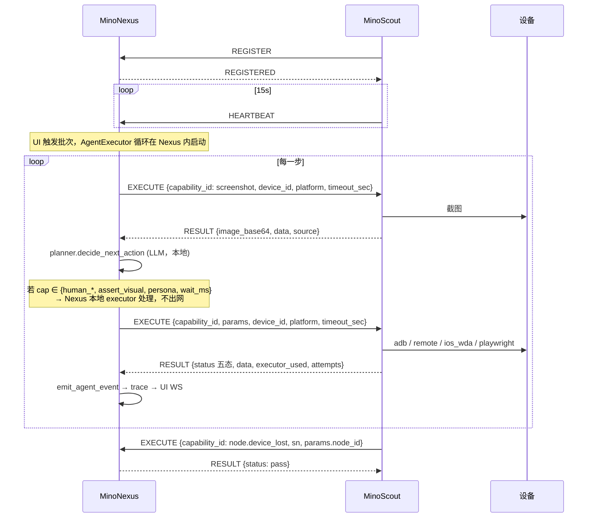

# PROTOCOL — MinoNexus ⇄ MinoScout

> **本文在 MinoNexus 与 MinoScout 两个仓库各有一份，必须逐字相同。**
> 契约真源是 `tests/fixtures/protocol/*.json`（两仓字节相同）。改协议的流程见各仓 `CLAUDE.md` §5。
> 协议版本：`2`

用例步骤与框架指令的统一出入口是 `EXECUTE` → `RESULT`。截图、层级、探活、取消 run、节点 stop/restart/update、设备热插拔都是 `capability_id`，走同一套形状。线上只有五种 `type`：`REGISTER` / `REGISTERED` / `HEARTBEAT` / `EXECUTE` / `RESULT`。没有 `OBSERVE` / `PROBE` / `CANCEL_RUN` / `NODE_EVENT` / `NODE_COMMAND`。

加字段时 dumps **省略空值**（`device_id` / `platform` 空字符串、`data` 空 dict）。

---

## 1. 传输与连接

| 项 | 规定 |
|---|---|
| 传输 | WebSocket，文本帧，UTF-8 JSON，一帧一条消息 |
| 方向 | **Scout 主动 dial Nexus**。Scout 永不监听对外端口 |
| 端点 | `ws(s)://<nexus-host>:<port>/node` |
| 单机默认 | `ws://mino.local:10104/node` |
| 鉴权 | 首帧 `REGISTER` 携带 `token`（配对时由 Nexus 下发）。Nexus 校验失败即关闭连接，close code `1008` |
| 重连 | Scout 侧指数退避（1s → 2s → 4s → … 上限 30s），无限重试 |
| 心跳 | Scout 每 15s 发 `HEARTBEAT`；Nexus 45s 未收到视为节点掉线 |
| 大载荷 | 截图以 base64 放在 JSON 里。单帧上限 32 MiB；超限时 Scout 必须降质重发而不是分片 |

## 2. 消息信封

所有消息共用同一信封：

```json
{
  "v": 2,
  "type": "EXECUTE",
  "msg_id": "01J8ZQ...",
  "reply_to": null,
  "ts": "2026-09-02T15:30:01.123456+08:00",
  "payload": { }
}
```

| 字段 | 类型 | 说明 |
|---|---|---|
| `v` | int | 协议版本。收到不认识的版本：Nexus 关连接并在 UI 报错；Scout 关连接并退避重连 |
| `type` | str | 见 §3 |
| `msg_id` | str | ULID。发送方生成，全局唯一 |
| `reply_to` | str \| null | 应答类消息填对应请求的 `msg_id` |
| `ts` | str | ISO-8601 带时区 |
| `payload` | object | 各消息自己的载荷 |

**应答规则**：`ACK 必须` 的消息，接收方必须回一条 `reply_to` 指向它的消息；发送方超时未收到则按 §6 重试。

---

## 3. 消息总表

| # | 方向 | `type` | ACK | 说明 |
|---|---|---|---|---|
| 1 | S→N | `REGISTER` | 必须 | 上报身份、能力、挂载设备。应答 `REGISTERED` |
| 2 | N→S | `REGISTERED` | — | `REGISTER` 的应答 |
| 3 | S→N | `HEARTBEAT` | 否 | 保活 + 连通性/设备变化增量 |
| 4 | 双向 | `EXECUTE` | 必须 | 能力或框架指令。N→S：截图 / 点击 / `probe` / `cancel_run` / `node.stop` 等。S→N：`node.device_lost` 等热插拔 |
| 5 | 双向 | `RESULT` | — | `EXECUTE` 的应答，靠 `reply_to` 配对 |

> **协议里没有 `DECIDE` / `STEP_EVENT` / `RUN_FINISH` / `NEED_HUMAN`。**
> 执行循环在 Nexus（见 [ARCHITECTURE.md](ARCHITECTURE.md)），决策、trace 落库、问人全部在 Nexus 本地完成，不过网。
> 用例主通信只剩 `EXECUTE` ↔ `RESULT`。

---

## 4. 各消息载荷

### 4.1 `REGISTER`（S→N，ACK 必须）

```json
{
  "node_id": "3f8a1c0e9b2d4f71",
  "token": "<pair-token>",
  "platform": "darwin",
  "arch": "arm64",
  "scout_version": "0.1.0",
  "protocol_version": 2,
  "hostname": "mac-studio.local",
  "studio_id": "a1b2c3d4e5f67890",
  "executors": [
    {"id": "adb", "available": true,
     "provides": ["system_shell","system_pkg_install","system_pkg_clear","read_system_data",
                  "ui_native_input","ui_input_text","ui_screenshot",
                  "app_launch_native","app_force_stop","clipboard_set","key_event"]},
    {"id": "remote", "available": true,
     "provides": ["ui_native_input","ui_input_text","ui_screenshot","ui_stream",
                  "app_launch_native","clipboard_set","key_event","system_pkg_install",
                  "read_system_data","exec_script"]},
    {"id": "ios_wda", "available": false, "provides": [], "reason": "no WDA runtime"},
    {"id": "playwright", "available": true, "provides": ["ui_native_input","ui_screenshot"]}
  ],
  "devices": [
    {"sn": "R5CT30xxxx", "platform": "android", "model": "SM-S9210",
     "channels": {"adb": "connected", "remote": "connected"}},
    {"sn": "claw-abc123", "platform": "android",
     "channels": {"adb": "disconnected", "remote": "connected"}},
    {"sn": "web3f8a1c0e9b2d4f71", "platform": "web", "channels": {"playwright": "connected"}}
  ]
}
```

| 字段 | 规定 |
|---|---|
| `node_id` | 节点稳定标识，**不等于任何 `sn`**。取值 `[a-z0-9]{16}`（Scout 持久化的 `scout_id`），重启后不变。Playwright 槽 `sn` 为 `web` + `node_id` |
| `hostname` | 本机主机名，可空。只作展示 |
| `studio_id` | 写入本机 Scout 配置的工作台 id（`[a-z0-9]{16}`），可空。Nexus 据此记归属 |
| `executors[].id` | 必须是 `adb` / `remote` / `ios_wda` / `playwright` / `desktop` 之一 |
| `executors[].provides` | **abstract cap id 列表**。取值域由 `catalog_entries`（`kind=abstract_cap`）定义（Nexus 侧真源），Scout 只报字符串 |
| `account_isolation_version` | 新版 Scout 固定上报 `1`，表示会在收到已认证 owner 后才恢复本地插件；缺失或不支持时 Nexus 拒绝注册（1008），不会消费安装凭证。旧节点需升级后重新连接 |
| `executors[].available` | `false` 时 `provides` 必须为空数组，并给 `reason` |
| `devices[].channels` | 取值：`connected` / `disconnected` / `unauthorized` / `not_applicable` |

Nexus 收到后：`provides` ∩ 能力目录 → 该节点可执行的 capability 集合；`devices[]` 写入设备表并标记 `node_id` 归属。

### 4.2 `REGISTERED`（N→S）

```json
{
  "accepted": true,
  "session_token": "<short-lived>",
  "heartbeat_interval_sec": 15,
  "nexus_version": "0.1.0",
  "protocol_version": 2,
  "warnings": ["device claw-abc123 未在 Nexus 侧登记，已自动创建"],
  "node_id": "3f8a1c0e9b2d4f71",
  "node_token": "<long-lived>",
  "owner_user_id": "<verified-user-id>"
}
```

| 字段 | 说明 |
|---|---|
| `node_id` | 可选。Nexus 重分配 id 时下发；Scout 写入 `config.scout_id` |
| `node_token` | 可选。首次用安装凭证 REGISTER 成功后换发的长期 token；Scout 写入 `config.token` 并替换安装凭证 |
| `owner_user_id` | 认证成功时必填，由 Nexus 凭证/会话解析。Scout 确认本地插件 owner 与服务源一致后才恢复机器人；缺失、冲突或历史未归属配置都停用，不能继承旧凭据 |

安装凭证由登录账号签发，15 分钟有效。首次注册在 SQLite 同一事务内绑定账号和节点、消费凭证并生成独立长期凭证；重复登记仅允许同一节点在有效期内恢复同一长期凭证。不同节点使用已消费凭证、无效/过期/吊销凭证、长期凭证与 node_id 不匹配及跨账号重装必须拒绝。拒绝后关闭连接（1008），不接受任意非空或共享环境 token。`studio_id` 仅兼容，不授予账号权限。

Scout 重装保留 `scout_id` 和已有长期 token，先以 `pending_install_token`、`pending_nexus_url` 尝试本次绑定；成功持久化长期凭证后清理临时字段。明确拒绝时清理临时字段并恢复原账号连接；新机器没有旧凭证则停止等待用户重新生成命令。协议版本仍为 2，REGISTERED 增加可选解码字段 `owner_user_id`；新版在线执行要求该值非空。同步更新 golden fixtures。

`accepted: false` 时必须给 `reason`，Scout 记录后按退避重连（不要立刻重试，避免打爆）。

### 4.3 `HEARTBEAT`（S→N，不需 ACK）

```json
{
  "node_id": "3f8a1c0e9b2d4f71",
  "uptime_sec": 3721,
  "busy": true,
  "active_runs": ["run_20260902_153001_R5CT30"],
  "device_delta": [
    {"sn": "R5CT30xxxx", "channels": {"adb": "disconnected", "remote": "connected"}}
  ],
  "device_workload": [
    {"sn": "R5CT30xxxx", "run_id": "run_20260902_153001_R5CT30", "step_idx": 3, "capability_id": "tap"}
  ],
  "scout_version": "0.1.29",
  "host": {
    "mode": "running",
    "power_source": "ac",
    "charging": "not charging",
    "battery_percent": 80,
    "inhibit": true,
    "cpu_percent": 3.2,
    "rss_mb": 180.0,
    "children": {"Chromium": 1, "caffeinate": 1, "adb": 2}
  },
  "plugins": [
    {"class": "mail", "id": "gmail", "installed": true, "configured": false},
    {"class": "cli", "id": "feishu", "installed": false, "configured": false}
  ]
}
```

`host` 可省略。旧 Scout 不带时，列表功耗格显示「—」。`mode` 为 `running` 或 `asleep`。`power_source` 为 `ac` / `battery`。`charging` 为 `charging` / `not charging` / `charged` / `discharging`。`inhibit` 表示睡眠抑制还在（macOS 上即 `caffeinate` 还活着）。`children` 只数本进程的子进程。

`plugins` 可省略。省略表示这台 Scout 还不认识插件状态，网页显示「需更新后才能配置插件」。每项必有 `class` / `id` / `installed` / `configured`。非密钥明文放在 `values`（如 Gmail `inbox_address`），已写入保险库的字段名放在 `saved_secrets`。密钥值不上报。`class` 为 `cli` / `mcp` / `bot` / `mail` / `im`。`REGISTER` 使用同一份列表。

LangBot（`class=im,id=langbot`）的 `status` 描述进程，`platforms[平台]` 描述渠道，各含 `enabled/holding/connected/error/last_message_at`。新增可选的 `connection_verified: bool` 和 `connection_source: recent_message|unconfirmed`：`connected` 保留旧客户端的进程与配置判定，只有 `connection_verified=true` 才能展示真实连接；字段缺失或 false 时显示「待确认」，不能仅凭配置、安装或进程推断在线。当前确认来源为本次进程启动后 120 秒内收到的真实渠道消息，超期重新待确认；不能提供适配器持续连接保证。Nexus 原样保留这些字段，再统一输出规范化 `im_channels`。微信与普通通知机器人不混算。此为可选字段扩展，协议版本保持 2。

`runtime_capabilities` 可省略。省略表示这台正在运行的进程没有上报输入契约，Nexus 不凭版本号猜测它是否支持当前焦点输入。列表只含执行器实际实现的组合：`id`、`executor`、`platform`、`contract_version`、`supported_combinations`（`target_mode` + `write_modes`）。`REGISTER` 与 `HEARTBEAT` 使用同一份列表；心跳带上它，重启后的新进程才会被当成支持新契约。

`device_delta` 只报**变化**的设备；无变化时可省略。Nexus 据此更新连通性，并在下一次组装菜单时生效。权威设备状态以心跳为准；`EXECUTE node.device_*` 是即时通知。

### 4.4 `EXECUTE`（双向，ACK 必须，幂等）

能力和框架指令的统一出入口。超过 `timeout_sec` 接收方必须停止等待并回 `RESULT status=fail`（见 §6）。

```json
{
  "run_id": "run_20260902_153001_R5CT30",
  "step_idx": 7,
  "sn": "R5CT30xxxx",
  "device_id": "R5CT30xxxx",
  "platform": "android",
  "capability_id": "tap_element",
  "params": {"x": 512, "y": 830},
  "executor_order": ["remote", "adb"],
  "low_level": {"command": "TAP", "params": {"x": "{x}", "y": "{y}"}},
  "selected_impl": {"id": "vlm_locate_remote_tap", "needs_vlm": true},
  "device_hint": {"adb_serial": "R5CT30xxxx", "password": "***", "ttl_sec": 3600},
  "timeout_sec": 30
}
```

| 字段 | 规定 |
|---|---|
| `capability_id` | 能力或框架指令 id。Scout 不校验它是否存在于目录（目录在 Nexus），只看自己的 executor `supports()` 或内置框架 cap |
| `params` | **坐标一律是 0–1000 归一化千分比，不是像素。** Scout 负责按实际分辨率换算。观察类能力可带 `compress_ratio` 等。点击带 `point_policy`，两条路径不混用。`coordinate`：只用 `x,y`，禁止文案锚点、禁止吸附邻近节点。`node`：只用 `target` 锚点，未命中则失败，禁止用坐标兜底。未带 `point_policy` 时，有 `x,y` 按 `coordinate` 处理，不锚点、不吸附 |
| `device_id` | 可选。设备唯一 ID；空则回退 `sn` / `device_hint`。**dumps 时空字符串省略** |
| `platform` | 可选。`android` \| `ios` \| `web` \| `playwright` \| `other`。空则从 `sn` / `device_hint` 猜测。**dumps 时空字符串省略** |
| `sn` | 设备串号；web/playwright 可为槽位 sn 或字面 `playwright` |
| `executor_order` | **由 Nexus 按这台 `sn` 算好**，只含该设备适用的通道（Web 不得含 `adb`，安卓/iOS 不得含 `playwright`）。同设备内的 fallback（如同一部安卓的 `adb`→`remote`）可以是列表；**禁止把不同类型设备的通道排进同一条链。** 非空时 Scout 只在该 `sn` 上按序尝试，类型不符的 executor **declined，不碰设备**。空则按 **该 sn 的 platform** 填：android→`adb,remote`，ios→`ios_wda`，web/playwright→`playwright`。**禁止** other 四通道混排 |
| `low_level` | 抄自能力目录 YAML 的 `low_level` 段。`{x}` 这类占位符由 Scout 用 `params` 填充 |
| `device_hint` | Nexus 注入的设备凭据，避免 Scout 回查。Web 可含 `headless: true`（Chromium 无头）。**含敏感字段，不得写入 Scout 的日志** |
| `timeout_sec` | 本动作上限。超时回 `fail`，见 §6 |

**幂等**：`(run_id, step_idx)` 是唯一键。Scout 必须缓存已完成的 `(run_id, step_idx) → RESULT`（建议保留至该 run 结束或 10 分钟），重复收到时**直接返回缓存结果，不重新执行**。`step_idx < 0` 不做幂等（截图/探活/框架事件每次都要发生）。

`compress_ratio`（`1.0` = 不压缩）对 **playwright 与 adb** 都生效：按比例缩小后，大于 1 时转 JPEG。Nexus 按渠道填入当前跑用例模型的 `web_compress_ratio` 或 `android_compress_ratio`，Scout 不读设置。**`RESULT` 里的 `width` / `height` 始终报原图尺寸**，坐标体系不受压缩影响。喂给大模型的图另按 `plan_compress_ratio` 统一转 JPEG，与渠道无关。

#### 4.4.1 `capability_id` 清单

| `capability_id` | 方向 | 说明 |
|---|---|---|
| `screenshot` | N→S | 截图。`params.compress_ratio` 对 playwright 与 adb 都生效 |
| `hierarchy` | N→S | UI 层级 dump |
| `get_app_version`（别名 `app_version`） | N→S | 目标包版本 |
| `get_foreground_app`（别名 `foreground_app`） | N→S | 前台包名 / bundle id |
| `probe`（别名 `probe_device`） | N→S | 重探连通性，结果在 `RESULT.data` / `extra.channels` |
| `cancel_run` | N→S | 不再继续该 run，不回滚已发到设备的动作 |
| `node.stop`（别名 `stop`） | N→S | 应答 RESULT 后 Scout 退出 |
| `node.sleep` | N→S | 不退出。放开睡眠抑制并关掉 Chromium，心跳继续，`host.mode=asleep` |
| `node.wake` | N→S | 节点仍连接时重新抑制睡眠。不在这一步开浏览器 |
| `node.restart`（别名 `restart`） | N→S | 应答后自拉起再退出 |
| `node.update`（别名 `update`） | N→S | 无远程装包路径则 `fail` |
| `node.log_tail` | N→S | 读本机 Scout 日志 tail。`params.lines` 默认 200，上限 2000 |
| `node.device_lost` | S→N | 设备消失。`params.node_id` / `detail` / `severity`；`sn`/`device_id` 为设备 |
| `node.device_found` | S→N | 设备出现 |
| `node.channel_changed` | S→N | 通道状态变化 |
| `node.engine_crashed` | S→N | WDA / u2 agent 等崩溃 |
| `node.shutting_down` | S→N | 人主动停。Nexus 立刻失败该节点在途 run。Scout 会在这条之前再发一帧 HEARTBEAT |
| `node.update_progress` | S→N | 远程/本机自更新进度。`params.progress`：`stage` / `label` / `percent` / `layer` / `bytes_*` |
| `node.plugin_install` | N→S | 按发布清单安装一个 CLI / MCP。`params.class` + `params.id`。不接受临时 URL |
| `node.plugin_remove` | N→S | 卸掉该插件目录，并删掉它在本机保险库里的密钥 |
| `node.plugin_config` | N→S | 写入该插件参数。密钥只留在 Scout 本机保险库，应答里不回显 |
| `node.plugin_progress` | S→N | 插件安装进度。形状同 `node.update_progress`，另带 `class` / `id`，不写入自更新的 `update_job` |
| `plugin.gmail.fetch_otp` | N→S | 用这台节点自己的 Gmail 应用专用密码取验证码。参数只有 To、时间、发件人过滤和轮询预算，没有密码 |
| `plugin.cli.feishu` | N→S | 用这台节点的飞书应用凭证读文档。参数是 `action=read_doc` 和 `url`，没有 `app_secret` |
| `plugin.cli.meego` | N→S | 用这台节点的 Meego 插件凭证换票或查工作项。参数没有 `plugin_secret` |
| `plugin.bot.send` | N→S | 飞书机器人或企业微信 webhook 发文本。`kind` 为 `feishu_bot` / `wecom`，没有 webhook |
| `plugin.bot.wechat` | N→S | 这台机器上的微信扫码、状态、发送。回执没有 `bot_token` |
| `node.plugin_wechat_message` | S→N | **旧事件，仅为兼容旧版 Scout 保留**，新版 Scout 发 `node.plugin_im_message`。微信收到一条文本。Nexus 生成回复后再发 `plugin.bot.wechat`。不在日志里写正文 |
| `node.plugin_im_message` | S→N | IM 收到一条消息（微信 iLink、LangBot 渠道）。`params.im` 为统一形状：`channel` / `instance_id`（实际机器人实例，必须与节点快照一致） / `tenant` / `chat_id` / `chat_type`(`private`\|`group`) / `sender_id` / `msg_id` / `text`(≤2000) / `mentioned` / `reply_ctx`(不透明的字符串字典，原样回传) / `recent_turns`(本会话最近至多 8 轮 `{role,text,ts,instance_id,tenant,sender_id}`，每条 ≤500 字，由 Scout 本地库取出)。Nexus 不落正文，不在日志里写正文。身份按 channel + instance_id + tenant + sender_id 精确绑定，并校验节点 owner 与持有权；绑定码只属于该 owner，一次性消费。缺实例或消息 ID 的旧回调不执行；收到消息先原子去重，群聊不能借用其他发送者身份。历史按 owner + 实例 + 租户 + 实际发送者隔离；Nexus 只接受当前绑定确认之后的历史，不把旧绑定或群内其他成员的正文作为上下文。每次模型调用、工具执行及回复前复核绑定代次，解绑或重新绑定使旧请求失效 |
| `plugin.im.send` | N→S | 经该节点向某个会话发一条消息。`channel` / `chat_id` / `sender_id` / `reply_ctx` / `text`。Scout 把发出的正文写入本地库。回执 `data.ok` |
| `plugin.im.history` | N→S | 读这台节点本地库里某个会话的正文。`channel` / `chat_id` / `sender_id` / `reply_ctx`（instance_id、tenant） / `after_ts`（当前绑定时间） / `limit`(≤100)。回执 `data.messages=[{role,text,ts,instance_id,tenant,sender_id}]`。正文只经这个能力现取，Nexus 不缓存 |
| `tap_element` 等 | N→S | 仍走 executor；Nexus 给该 sn 的 `executor_order`，Scout 按 sn 执行 |

`node.stop` / `node.restart`：Scout core 在 RESULT 的内部 extra 里打标记，transport 回完 RESULT 后再 shutdown。**不能靠 `node.stop` 或 `node.wake` 启动一台已经离线的专机。** `node.sleep` 不打退出标记。

S→N 的框架事件可丢（超时未等到 RESULT 时 Scout 只记 warn）；权威状态以 `HEARTBEAT.device_delta` 为准。

#### 4.4.2 `hierarchy` 的 RESULT 形状（NavFSM 依赖，两仓钉死）

`hierarchy` 是**结构化**的，不是一坨文本。`RESULT.data["nodes"]` 是节点数组，
`RESULT.extra["nodes"]` 是同一份数据的镜像（Scout 侧 `_result_from_event` 同时填两处），
接收方读任一即可，**不要**假设只有其中一个存在。

```json
{
  "status": "pass",
  "summary": "UI 层级 128 节点",
  "executor_used": "adb",
  "data": {
    "source": "adb",
    "elapsed_ms": 41,
    "nodes": [
      {
        "resource_id": "com.example.app:id/tab_feed",
        "text": "Tab A",
        "content_desc": "",
        "class": "android.widget.TextView",
        "clickable": true,
        "bounds": [0, 1848, 270, 1968],
        "center": [135, 1908]
      }
    ]
  },
  "extra": {"nodes": [/* 同上 */]}
}
```

| 字段 | 规定 |
|---|---|
| `hierarchy_format` | **`accessibility_json`**。这是本协议唯一的 hierarchy 形态；`flat_text` / `xml_dump` 不是协议形态，只能是接收方自己派生的展示文本 |
| `nodes[].resource_id` | 完整 id，含被测应用包名前缀（`{package}:id/...`）。可能为空串 |
| `nodes[].text` / `content_desc` | 可见文本 / 无障碍描述。可能为空串 |
| `nodes[].class` | 控件类名全称 |
| `nodes[].clickable` | 布尔 |
| `nodes[].bounds` | `[left, top, right, bottom]` |
| `nodes[].center` | `[x, y]` |
| `data.source` | 采集**通道** id，当前恒为 `adb`（与 `executor_used` 同值）。Scout 内部的 dump 来源（u2 / exec-out / 落盘）只进 Scout 日志，不上协议 |
| `data.elapsed_ms` | 本次 dump 耗时 |

> **坐标体系警告**：`bounds` / `center` 是**设备像素**，与 §4.4 里 `params` 的 **0–1000 千分比**
> **不是同一个体系**。拿 hierarchy 的坐标直接塞进 `tap_element.params` 会点偏。要换算的一方自己按
> `RESULT.width` / `height`（截图报的原图尺寸）折算。

**通道限制与失败语义**：

| 场景 | 行为 |
|---|---|
| web / playwright 槽 | `status=pass`，`data.source=playwright`，`nodes` 为 **DOM 快照**（`input`/`button` 等，`class` 为 HTML tag 或 `tag:type`）；**不是**安卓 `android.widget.*` |
| 非 adb 序列号（如远程 `claw-` 设备） | `status=fail`；`remote` / `ios_wda` 通道待后续版本 |
| dump 失败（设备忙 / agent 挂） | `status=fail`，`error` 汇总各来源的失败原因 |

`hierarchy` 是观察类能力，`step_idx=-1`，**不做幂等缓存**。Scout 侧有 1.5s 的 TTL dump 缓存，
动作执行后会主动失效；调用方要最新一帧就跟在动作之后取。

Nexus 侧收到 `fail` 时**不得**让本 turn 失败：按 `docs/NAVIGATION_ATLAS.md` §10.0.2 降级
（`hierarchy_text` 置空、localize 退回 session + history、GuardGate 本 turn 不 block）。


### 4.5 `RESULT`（双向）

所有 `EXECUTE` 共用应答类型，靠 `reply_to` 区分。

```json
{
  "run_id": "run_20260902_153001_R5CT30",
  "step_idx": 7,
  "status": "pass",
  "summary": "remote TAP (512,830) -> ok",
  "error": "",
  "executor_used": "remote",
  "source": "remote",
  "elapsed_ms": 412,
  "attempts": [
    {"executor": "remote", "status": "pass", "elapsed_ms": 412}
  ],
  "image_base64": "",
  "image_mime": "",
  "width": 0,
  "height": 0,
  "extra": {},
  "data": {}
}
```

| 字段 | 规定 |
|---|---|
| `status` | **五态之一（小写）**：`pass` / `fail` / `skipped` / `blocked` / `declined`。取值与上游 `EventStatus` 逐字一致。Router 的处置见 §4.5.1。超时用 `fail` |
| `executor_used` | 实际执行的 executor id。**不可省略**，Nexus 的 trace 与覆盖度依赖它 |
| `attempts` | fallback 链的逐次记录。全部失败时 `status` 取最后一次的结果 |
| `image_*` / `width` / `height` | 截图时填；也同时放进 `data` |
| `data` | 任意返回参数（截图、层级 nodes、probe channels、能力原始结果）。**空 dict 时 dumps 省略** |
| `error` | 失败原因，面向人。**不得包含 `device_hint` 里的凭据** |

Scout **任何情况下不得让异常逃出** —— 内部异常一律转成 `status: "fail"` + `error`。Nexus 收到 S→N 的框架 `EXECUTE` 后必须回 `RESULT`，不能让 Scout 干等。

#### 4.5.1 五态与 Router 处置

取值与上游 `server/services/ai/regression/schemas.py::EventStatus` 逐字一致（**小写**，且是 `pass` 而不是 `OK`），避免搬迁时到处翻译名字。

| status | Router 行为 | 语义 |
|---|---|---|
| `pass` | 立即返回 | 做成了 |
| `blocked` | **立即返回** | 需要人介入 —— 换 executor 没有意义 |
| `declined` | 试下一个 executor | 主动让位，**不算故障**（日志 info，不计失败） |
| `fail` | 试下一个 executor | 真故障，但仍兜底换通道再试一次 |
| `skipped` | 试下一个 executor | 本次未执行（前置不满足等） |

**`declined` 与 `fail` 都会走 fallback**，区别在**是否算故障**，不在"换个 executor 有没有用"。只有 `blocked` 会中断 fallback 链。

`skipped` 是 executor 也会返回的值（上游 executors 里出现 6 次），不是 Nexus 独有的编排态。

---

## 5. 时序



---

## 6. 超时、重试、幂等

| 场景 | 规定 |
|---|---|
| Nexus 等 `RESULT` 超时 | 用 `payload.timeout_sec` + 5s 宽限。超时后按同一 `(run_id, step_idx)` 重发一次；再超时记 `fail`，原因 `scout timeout` |
| Scout 执行超过 `timeout_sec` | 立刻回 `RESULT status=fail`，`error` 说明超时。实现是 `fut.result(timeout=timeout_sec)`：**Python 线程无法强杀**，底层 adb / 设备动作可能仍在跑 |
| Scout 收到重复 `(run_id, step_idx)` | 返回缓存的 `RESULT`，**不重新执行** |
| 连接断开 | Scout 退避重连并重发 `REGISTER`。在途 `EXECUTE` 的结果若已产生，重连后 Nexus 重发同键请求即可取到缓存 |
| Nexus 重启 | Scout 的 `REGISTER` 会重建节点登记。在途 run 由 Nexus 侧判为中断，不尝试续跑 |
| S→N 框架 `EXECUTE` / `HEARTBEAT` 丢失 | 允许。状态最终由下一次 `HEARTBEAT` 收敛 |

**Scout 侧不做业务重试。** 同一动作、**同一台 sn** 换 executor（如安卓 `adb`→`remote`）由 `executor_order` 表达；不得用列表把 Web 和安卓通道串起来。同一 executor 内的机械重试（如 adb 偶发 `device offline`）允许，但必须记进 `attempts`。

---

## 7. 兼容性

- **加字段**：允许，接收方必须忽略不认识的字段
- **加消息类型**：允许，接收方对未知 `type` 记 warn 并忽略（不可关连接）
- **改字段语义 / 删字段 / 改 `type` 名**：不允许，必须 `v` 加一
- 双方在 `REGISTER` / `REGISTERED` 交换 `protocol_version`，不一致时**低版本方拒绝连接并明确报错**，不做降级协商

---

## 8. Fixture 哈希

契约真源：`tests/fixtures/protocol/`。两仓必须一致。

```
fixtures_sha256 = 969650f50b05d4f67826aeb198b3ee04720ddb945f2f812f5235b83f3307c865
```

两仓各自确认：① `protocol.py` 能 round-trip 全部 fixture；② fixture 目录哈希与上面记录一致。

哈希算法：按 JSON 文件名字典序拼接每份 `文件名 UTF-8 + 换行 + 原始文件字节`，再取 SHA-256。


## 9. Desktop additive contract (2026-10-12)

协议保持 v2；新字段均可缺省，不按 Scout 版本猜桌面能力。旧设备 fixture 不增加空字段。

- `REGISTER.host` 与 `HEARTBEAT.host` 由 Scout 上报实际 OS/arch/hostname 与 `desktop` 探测状态。持久化在 SQLite `nodes.extra`。
- `DeviceManifest` 增加 `os`（macos/windows/linux）、持久逻辑槽 `session_key`、临时 `session_generation`、`desktop_state`、`blocked_reason`、可空 `capabilities` 和 `readiness`。持久化在 SQLite `m_device.extra`，设备家族为 `platform=desktop`。
- 主桌面 SN 为 `desktop:<node_id>:console`。一个节点只能上报自己的槽及实际宿主 OS；窗口和显示器不生成设备。无 GUI/锁屏/缺权限/缺插件保留逻辑槽且通道为 disconnected，不表示可执行。
- `HEARTBEAT.executors` 是可缺省的执行器状态增量，用于权限或插件变化后刷新 Desktop 的 available/provides/reason；不发送时保留旧状态。
- `device_delta` 比较完整 manifest；会话代次、能力或权限变化也必须发送。Nexus 替换完整设备状态，不能只合并 channels。
- `EXECUTE.device_hint` 带 `os/session_key/session_generation/desktop_lease/target_package`。任务创建时冻结代次，Desktop 输入必须持有当前任务的 SQLite 独占租约。Scout 重启或 Cua readiness 状态变化使旧代次失效，不能用新心跳给旧任务续代次；系统会话及窗口的实际输入准入由 SDK 最终校验。
- Desktop 只路由 `desktop` executor。未知平台显式拒绝，不落回 ADB 或 Playwright。截图 capture_id、OS session_generation、SDK snapshot_id 与报告截图 hash 是不同身份。
- SDK 连接在一个桌面 worker 中持续复用。每次动作尝试消费最近一次截图引用，捕获绑定点击使用 Cua capture_id；超时视为结果未知，停止该 runtime 后续操作，不能自动换通道再输入。取消阻止新动作，不回滚已发生的输入。
- Desktop 与该节点 headed Web 共享 `desktop:<node_id>:console` 锁；headless Web 保留四路独立并发。SQLite 事务同时建立设备租约和任务，终态释放租约。
- Native macOS/Windows 采用 Cua Driver 0.34.1，按锁定 SDK wheel API 对齐；会话、权限与平台 readiness 消费 Cua health_report，窗口捕获和输入准入由 Cua 校验，Linux 暂不开放执行。Windows fixtures 覆盖就绪、锁屏与 Session 0；真实硬件验收与二进制发布另行记录，不将契约验证当作实机通过。Cua perception 不在此切片。
- `RESULT.extra` 保留精简动作证据 `cua_action`（effect/route/delivery/error.code/escalation），不保存输入正文或 SDK 原始 JSON。Nexus 在 `tool/result` 追加可信派单元信息 `scout`、`attempts` 和 `desktop`；未涉及任务的进程启动/注册/重连日志仍仅在 Scout 本地日志中。

## Desktop 输入与执行证据补充（0.1.76）

不改变消息 envelope 或 fixture 字段。Desktop `input_contract` 按 executor 上报 `current_focus` + `replace` / `append`，Nexus 不复用 Android 的 ADB 输入准入规则。点击使用服务端注入的、绑定 run_id 与事件 seq 的 focus_ref；Scout 保存窗口与字段落点，在新窗口捕获中经 Cua 重新定位字段，再执行窗口输入，引用不能跨代际或任务复用。不再使用项目原生焦点探针。

OBSERVE 的 screenshot 与 RESULT 的执行诊断通过 capture_id、session_generation 对齐。Nexus 的 Session Log 主动作和恢复子动作记录实际 executor、节点、尝试链、桌面 effect/route 与 evidence.kind；不复制原生证据自由文本详情。截图引用来自 Scout，网页所属系统不能替代节点上报的宿主 OS。

## Desktop 窗口托管补充（2026-10-12）

消息 envelope 和 protocol dataclass 不变；以下元数据经既有 screenshot `remote_detail` 与 RESULT `extra` 传输。

- Nexus 在 PC 首张截图前派发 `launch_app`，Scout 用 Cua 启动/激活应用并绑定 `target={kind:window,pid,window_id}`。`launch_app.params.window_id` 或 `device_hint.window_id` 可明确选窗；目标窗口不可唯一选择时 blocked。每个 run 保存独立绑定，取消、超时与代际变化清理绑定。
- 截图使用 SDK 通用 `get_window_state`，指定 pid/window_id，关闭 AX 树并注册动作捕获（display_only=false）。typed WindowStateOutput 未暴露 capture_id，因此不能拿 snapshot_id 冒充捕获引用。不调用整屏截图，也不在窗口截图失败后改截桌面。
- screenshot 元数据含 capture_scope=window、target、pid/window_id、snapshot_id、capture_id、session_generation、capture_width/capture_height、native_width/native_height、window_bounds、screenshot_scale、compress_ratio。capture 尺寸始终对应返回给模型的最终图像。PC 压缩默认 1，较大压缩比通过 Cua 原尺寸校准后设置 max_image_dimension；项目不再自行缩图。
- 点击使用 ActionTarget.WINDOW 与 ClickPosition.CAPTURED_COORDINATES，Cua 原子校验捕获、所有者、窗口几何与有效期，处理 Retina/压缩映射并消费捕获。输入和按键也绑定窗口，显式 delivery_mode=foreground；项目不向整个桌面投递坐标或键盘事件。
- 前台状态读取使用 Cua list_apps.active；健康、权限和会话诊断使用 health_report，不读取项目自研平台探针。generation 跟随 Scout 生命周期及 Cua readiness 状态变化；窗口与捕获是否仍可动作由 SDK 最终校验。
- tool/call 在窗口准备派发前写入；tool/result.desktop 保留窗口 target/capture_scope、捕获身份和安全动作证据，observe/screen 保留 pid/window_id、图像尺寸及缩放信息，便于核对是否确实为指定窗口。
